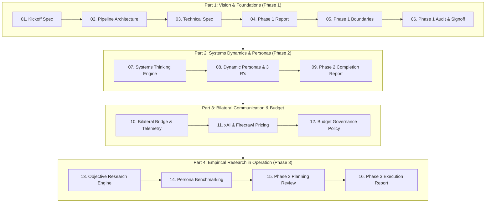

# HomePilot Market Intelligence Engine — Master Documentation Library

**Repository:** `External Website Research Tool`  
**Purpose:** Central Knowledge Base & Architecture Archive  
**Audience:** Internal Operators & Developers (2 Operators)  
**Strict Boundary Isolation:** 100% Independent of `Mortgage_calculator_QA` (Zero shared code, policies, or connections)  

---

This directory contains the complete archive of all technical specifications, strategic blueprints, budget models, and execution reports produced throughout the project lifecycle.

## Table of Contents & Reading Order



---

### Part 1: Architecture, Foundations & Boundaries (Phase 1)
1. [market_intelligence_researcher_kickoff.md](market_intelligence_researcher_kickoff.md)
   - *Kickoff charter, core objectives, and initial mandate.*
2. [homepilot_intelligence_pipeline_architecture.md](homepilot_intelligence_pipeline_architecture.md)
   - *End-to-end 7-stage pipeline architecture (Source Discovery $\rightarrow$ Normalisation $\rightarrow$ LLM Relevance $\rightarrow$ Review Queue).*
3. [homepilot_market_intelligence_technical_spec.md](homepilot_market_intelligence_technical_spec.md)
   - *Master technical specification: 12-category taxonomy, 6-dimension scoring formula (0–100), and MongoDB 14-collection Hub-and-Spoke schemas.*
4. [homepilot_phase1_implementation_report.md](homepilot_phase1_implementation_report.md)
   - *Phase 1 verification report detailing the initial code modules, FastAPI service, and queue manager.*
5. [homepilot_phase1_architecture_and_boundaries.md](homepilot_phase1_architecture_and_boundaries.md)
   - *Strict boundary rules: zero shared code/policies with mortgage calculator, GitHub CI/CD, and 2-person operator model.*
6. [homepilot_phase1_quality_check_and_signoff.md](homepilot_phase1_quality_check_and_signoff.md)
   - *Quality audit and formal verification of Phase 1 requirements.*

---

### Part 2: Systems Dynamics, BPM & Dynamic Personas (Phase 2)
7. [homepilot_systems_thinking_strategic_engine.md](homepilot_systems_thinking_strategic_engine.md)
   - *Meadows/Sterman systems dynamics: Stocks & Flows (Buyer Cash Reserve vs Hidden Fee Drains), Time Lags (conveyancing delays), and the Iceberg Model.*
8. [homepilot_phase2_systems_thinking_and_persona_evolution.md](homepilot_phase2_systems_thinking_and_persona_evolution.md)
   - *Dynamic persona discovery (`dyn_seg_commuter_cap_straddler`), BPM customer journey mapping, and the **Three R's (Role, Rule, Route)** duty allocation between Bot Squad and Human Operators.*
9. [homepilot_phase2_execution_and_completion_report.md](homepilot_phase2_execution_and_completion_report.md)
   - *Phase 2 completion report, test verification (21/21 green), and monitoring pipeline verification.*

---

### Part 3: Bilateral Communication, Telemetry & Budget Governance
10. [homepilot_bilateral_communication_and_cost_optimization_report.md](homepilot_bilateral_communication_and_cost_optimization_report.md)
    - *3-tier bilateral communication bridge (Python $\leftrightarrow$ Firecrawl 4-stage filtering funnel, Python $\leftrightarrow$ GrokBot, GrokBot $\leftrightarrow$ Operator review queue) and PostHog operational telemetry.*
11. [homepilot_api_pricing_and_ingestion_capacity_analysis.md](homepilot_api_pricing_and_ingestion_capacity_analysis.md)
    - *Comparative pricing analysis: Firecrawl Hobby (€14 for 5,000 pages) + xAI API (€25 for Grok tokens) + MongoDB Atlas Free ($< €10).*
12. [homepilot_budget_governance_and_efficiency_architecture.md](homepilot_budget_governance_and_efficiency_architecture.md)
    - *Hard quota policies, real-time burn tracking in `BudgetGovernanceTracker`, zero-waste markdown scraping, and future scaling roadmap.*

---

### Part 4: Empirical Research Engine in Operation (Phase 3)
13. [homepilot_objective_driven_research_engine.md](homepilot_objective_driven_research_engine.md)
    - *Objective-driven empirical research architecture: formulating testable market hypotheses and evidence gap identification.*
14. [homepilot_research_engine_persona_benchmarking.md](homepilot_research_engine_persona_benchmarking.md)
    - *Continuous market-to-persona research benchmarking: mapping live feed signals against `seg_1` through `seg_5` and dynamic segments.*
15. [homepilot_phase3_planning_and_roadmap_review.md](homepilot_phase3_planning_and_roadmap_review.md)
    - *Audit of Phases 1 & 2 and detailed requirements for Phase 3 operationalization.*
16. [homepilot_phase3_execution_and_completion_report.md](homepilot_phase3_execution_and_completion_report.md)
    - *Phase 3 execution report: Public dataset connectors (PPR, CSO PxStat API, RTB), automated daily morning briefing generator (07:00 UTC), and interactive operator review CLI.*
17. [homepilot_api_connections_mongodb_and_operator_handbook.md](homepilot_api_connections_mongodb_and_operator_handbook.md)
    - *Live API connections handbook (Firecrawl & xAI), MongoDB 14-collection architecture, and explicit division of responsibilities between human operators and the automated assistant.*

---

### Part 5: Live Ingestion Connectors, Dynamic Taxonomy & xAI Discourse
18. [homepilot_firecrawl_integration_and_live_pipeline_report.md](homepilot_firecrawl_integration_and_live_pipeline_report.md)
    - *Live Firecrawl API integration, clean markdown scraping, search-then-scrape pattern, and Facebook FTB community discovery.*
19. [homepilot_taxonomy_dynamics_and_authority_expansion.md](homepilot_taxonomy_dynamics_and_authority_expansion.md)
    - *Dynamic query formulation, keyword evolution, and automated discovery of new authoritative Irish sources.*
20. [homepilot_xai_grok_integration_and_live_execution_report.md](homepilot_xai_grok_integration_and_live_execution_report.md)
    - *Live verification of xAI API (Grok), real-time X platform discourse extraction, token accounting, and persistent budget tracking.*
21. [homepilot_xai_strategic_intelligence_and_communication_framework.md](homepilot_xai_strategic_intelligence_and_communication_framework.md)
    - *Strategic intelligence framework: X discourse mining, high-utility signal vs political noise, future bot communication synthesis, and 3 R's human validation gate.*

---

### Part 6: Theme Clustering, Asset Blueprints & GitHub Operations (Phase 4)
22. [homepilot_phase4_and_phase5_roadmap_and_github_setup.md](homepilot_phase4_and_phase5_roadmap_and_github_setup.md)
    - *High-level roadmap for Phases 4 and 5, with explicit instructions for GitHub remote linking and CI/CD automation.*
23. [homepilot_phase4_deep_research_and_execution_plan.md](homepilot_phase4_deep_research_and_execution_plan.md)
    - *Deep research specifications for multi-source theme clustering, asset blueprint generation, Rule B-02 double citation guard, and Grok Bot operator review dialogue.*
24. [homepilot_phase4_execution_and_completion_report.md](homepilot_phase4_execution_and_completion_report.md)
    - *Phase 4 completion report: multi-source clustering, 8 generated blueprints, live dual operator sign-off in MongoDB, and 54/54 tests passing.*

---

### Part 7: Closed-Loop Feedback & System Engineering Audits
25. [homepilot_closed_loop_research_feedback_architecture.md](homepilot_closed_loop_research_feedback_architecture.md)
    - *Closed-loop bilateral feedback mechanism: querying internal MongoDB pool, flagging unanswered cold spots, and triggering periodic batched re-crawls.*
26. [homepilot_bilateral_semantic_wiring_and_brief_creation_roles.md](homepilot_bilateral_semantic_wiring_and_brief_creation_roles.md)
    - *Clear separation of roles: the Market Research Intelligence Engine owns semantic wiring & relationships, while GrokBot (with human validation) creates the brief.*
27. [homepilot_end_to_end_system_harmony_and_engineering_audit.md](homepilot_end_to_end_system_harmony_and_engineering_audit.md)
    - *Comprehensive engineering audit verifying kickoff charter alignment, elimination of dormant pathways, unified repository data access, and hermetic test database isolation.*
28. [homepilot_phase5_planning_and_execution_plan.md](homepilot_phase5_planning_and_execution_plan.md)
    - *Master architecture & execution plan for Phase 5: Autonomous background daemon (07:00 UTC), RFC 7807 error formatting, PII sanitization guards, PostHog telemetry dashboards, and Docker/CI-CD.*
29. [homepilot_phase5_execution_and_completion_report.md](homepilot_phase5_execution_and_completion_report.md)
    - *Phase 5 completion report: Zero-trust PII scrubbing, RFC 7807 middleware, autonomous scheduling daemon, Docker/CI-CD packaging, and turnkey MongoDB Atlas readiness.*
30. [homepilot_grokbot_desktop_and_mobile_synchronization_spec.md](homepilot_grokbot_desktop_and_mobile_synchronization_spec.md)
    - *GrokBot Desktop & Mobile Synchronization: Master persona prompt, 5 operational routines, and zero-config web & tunnel setup guide.*

---

## Current System Test Verification Status

```bash
source .venv/bin/activate && pytest -q
======================= 61 passed in 48.67s =======================
```
All 61 unit and integration tests across the entire codebase are 100% green.
