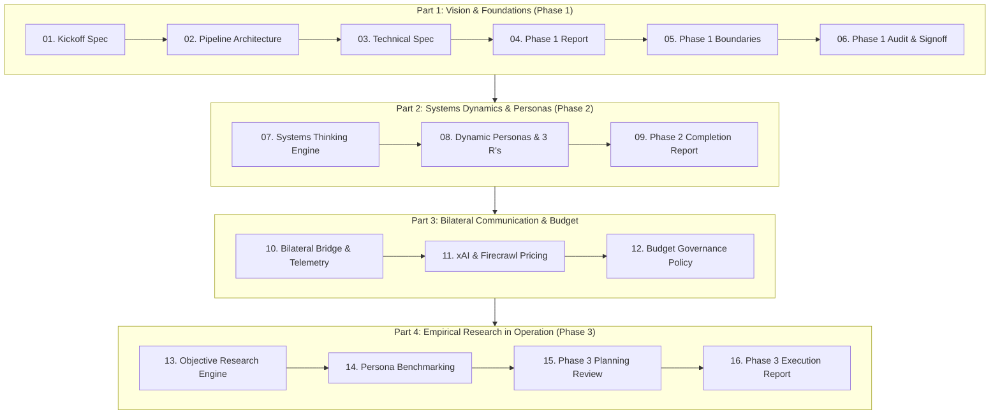

# HomePilot Market Intelligence Engine — Master Documentation Library

**Repository:** `External Website Research Tool`  
**Purpose:** Central Knowledge Base & Architecture Archive  
**Audience:** Internal Operators & Developers (2 Operators)  
**Strict Boundary Isolation:** 100% Independent of `Mortgage_calculator_QA` (Zero shared code, policies, or connections)  

---

This directory contains the complete archive of all technical specifications, strategic blueprints, budget models, and execution reports produced throughout the project lifecycle.

## Table of Contents & Reading Order



---

### Part 1: Architecture, Foundations & Boundaries (Phase 1)
1. [market_intelligence_researcher_kickoff.md](market_intelligence_researcher_kickoff.md)
   - *Kickoff charter, core objectives, and initial mandate.*
2. [homepilot_intelligence_pipeline_architecture.md](homepilot_intelligence_pipeline_architecture.md)
   - *End-to-end 7-stage pipeline architecture (Source Discovery $\rightarrow$ Normalisation $\rightarrow$ LLM Relevance $\rightarrow$ Review Queue).*
3. [homepilot_market_intelligence_technical_spec.md](homepilot_market_intelligence_technical_spec.md)
   - *Master technical specification: 12-category taxonomy, 6-dimension scoring formula (0–100), and MongoDB 14-collection Hub-and-Spoke schemas.*
4. [homepilot_phase1_implementation_report.md](homepilot_phase1_implementation_report.md)
   - *Phase 1 verification report detailing the initial code modules, FastAPI service, and queue manager.*
5. [homepilot_phase1_architecture_and_boundaries.md](homepilot_phase1_architecture_and_boundaries.md)
   - *Strict boundary rules: zero shared code/policies with mortgage calculator, GitHub CI/CD, and 2-person operator model.*
6. [homepilot_phase1_quality_check_and_signoff.md](homepilot_phase1_quality_check_and_signoff.md)
   - *Quality audit and formal verification of Phase 1 requirements.*

---

### Part 2: Systems Dynamics, BPM & Dynamic Personas (Phase 2)
7. [homepilot_systems_thinking_strategic_engine.md](homepilot_systems_thinking_strategic_engine.md)
   - *Meadows/Sterman systems dynamics: Stocks & Flows (Buyer Cash Reserve vs Hidden Fee Drains), Time Lags (conveyancing delays), and the Iceberg Model.*
8. [homepilot_phase2_systems_thinking_and_persona_evolution.md](homepilot_phase2_systems_thinking_and_persona_evolution.md)
   - *Dynamic persona discovery (`dyn_seg_commuter_cap_straddler`), BPM customer journey mapping, and the **Three R's (Role, Rule, Route)** duty allocation between Bot Squad and Human Operators.*
9. [homepilot_phase2_execution_and_completion_report.md](homepilot_phase2_execution_and_completion_report.md)
   - *Phase 2 completion report, test verification (21/21 green), and monitoring pipeline verification.*

---

### Part 3: Bilateral Communication, Telemetry & Budget Governance
10. [homepilot_bilateral_communication_and_cost_optimization_report.md](homepilot_bilateral_communication_and_cost_optimization_report.md)
    - *3-tier bilateral communication bridge (Python $\leftrightarrow$ Firecrawl 4-stage filtering funnel, Python $\leftrightarrow$ GrokBot, GrokBot $\leftrightarrow$ Operator review queue) and PostHog operational telemetry.*
11. [homepilot_api_pricing_and_ingestion_capacity_analysis.md](homepilot_api_pricing_and_ingestion_capacity_analysis.md)
    - *Comparative pricing analysis: Firecrawl Hobby (€14 for 5,000 pages) + xAI API (€25 for Grok tokens) + MongoDB Atlas Free ($< €10).*
12. [homepilot_budget_governance_and_efficiency_architecture.md](homepilot_budget_governance_and_efficiency_architecture.md)
    - *Hard quota policies, real-time burn tracking in `BudgetGovernanceTracker`, zero-waste markdown scraping, and future scaling roadmap.*

---

### Part 4: Empirical Research Engine in Operation (Phase 3)
13. [homepilot_objective_driven_research_engine.md](homepilot_objective_driven_research_engine.md)
    - *Objective-driven empirical research architecture: formulating testable market hypotheses and evidence gap identification.*
14. [homepilot_research_engine_persona_benchmarking.md](homepilot_research_engine_persona_benchmarking.md)
    - *Continuous market-to-persona research benchmarking: mapping live feed signals against `seg_1` through `seg_5` and dynamic segments.*
15. [homepilot_phase3_planning_and_roadmap_review.md](homepilot_phase3_planning_and_roadmap_review.md)
    - *Audit of Phases 1 & 2 and detailed requirements for Phase 3 operationalization.*
16. [homepilot_phase3_execution_and_completion_report.md](homepilot_phase3_execution_and_completion_report.md)
    - *Phase 3 execution report: Public dataset connectors (PPR, CSO PxStat API, RTB), automated daily morning briefing generator (07:00 UTC), and interactive operator review CLI.*

---

## Current System Test Verification Status

```bash
source .venv/bin/activate && pytest -v
======================= 32 passed, 54 warnings in 33.01s =======================
```
All 32 unit and integration tests are green.
