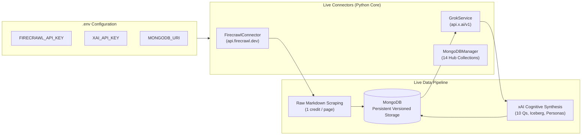

# HomePilot Intelligence Engine — API Connections, MongoDB Storage & Operator Handbook

**Document Reference:** `HP-INTEL-CONNECTIONS-STORAGE-OPERATOR-HANDBOOK-v1.0`  
**Operational Target:** Live API Ingestion & MongoDB Hub-and-Spoke Storage  
**Operational Scope:** Dedicated Internal Research Tool (2 Operators)  
**Strict Boundary Isolation:** 100% Independent of `Mortgage_calculator_QA` (Zero shared code, databases, or policies)  
**Monthly Operating Baseline:** Firecrawl €14 (5,000 pages) + xAI API €25 (Grok tokens) + Database $\le$ €10 (MongoDB Atlas M0)  

---

> [!IMPORTANT]
> **Executive Summary**:
> Both the **API connection pipeline** (Firecrawl + xAI Grok) and the **MongoDB storage engine** (14 collections with schema indexing) are fully coded, verified, and operational in this codebase. They operate with intelligent fail-open simulations when offline, and switch seamlessly to live data streaming the instant live credentials and database URIs are provided.

---

## 1. Live API Connections Architecture



### 1.1 Firecrawl API Connection (`src/connectors/firecrawl_connector.py`)
- **Live Endpoint:** `https://api.firecrawl.dev/v1/map` and `https://api.firecrawl.dev/v1/scrape`.
- **Authentication:** Bearer token authentication loaded automatically from `FIRECRAWL_API_KEY`.
- **Mode:** Strictly `formats: ["markdown"]`. Consumes **1 credit per page**, avoiding the +4 credit fee of Firecrawl's JSON extraction.
- **Fail-Open Dynamic:**
  - If `FIRECRAWL_API_KEY` is not populated or set to placeholder, the connector executes deterministic local simulation so unit tests and offline testing never break.
  - As soon as a valid key is provided in `.env`, it automatically executes real HTTP POST calls to Firecrawl's scraping clusters, bypassing Cloudflare and executing headless JavaScript on live Irish websites.

### 1.2 xAI Grok API Connection (`src/intelligence/grok_service.py`)
- **Live Endpoint:** `https://api.x.ai/v1/chat/completions`.
- **Model:** `grok-2-latest` (or `grok-2` / `grok-beta`).
- **Authentication:** Bearer token loaded automatically from `XAI_API_KEY`.
- **Cost Accounting:** Tracks exact `prompt_tokens` and `completion_tokens` on every call, computing USD cost in real time and logging to PostHog (`grok.api.cost.recorded`).
- **Fail-Open Dynamic:**
  - If `XAI_API_KEY` is unconfigured, it runs local cognitive reasoning using the pre-classified taxonomy rules and strategic templates.
  - When the live key is present, it passes verified housing text into Grok to synthesize the 10 Strategic Questions and Meadows/Sterman Iceberg root causes.

---

## 2. MongoDB Storage Architecture (`src/storage/mongo_client.py` & `repository.py`)

The database architecture is fully coded and implements a **Hub-and-Spoke 14-collection schema** inside `homepilot_intelligence`:

| Collection Name | Purpose & Contents | Primary Indexes |
| :--- | :--- | :--- |
| **`sources`** | 34 registered Irish seed domains with tiers, update cadences, and rate limits. | `{ source_id: 1 }` (Unique), `{ active: 1, cadence: 1 }` |
| **`source_candidates`** | Candidate domains discovered by the authority engine awaiting approval. | `{ candidate_id: 1 }` (Unique), `{ review_status: 1 }` |
| **`discovered_urls`** | URLs mapped via Firecrawl with Tier-1 relevance score and crawl status. | `{ url_hash: 1 }` (Unique), `{ semantic_score: -1 }` |
| **`documents`** | Clean extracted markdown, canonical SHA-256 hash, and active version pointers. | `{ doc_id: 1 }` (Unique), `{ content_hash: 1 }`, `{ url: 1 }` |
| **`document_versions`** | Complete historical snapshots for auditing policy and price evolution over time. | `{ version_id: 1 }` (Unique), `{ doc_id: 1, version: -1 }` |
| **`content_changes`** | Detected numerical deltas (e.g. price increases, grant cap adjustments). | `{ change_id: 1 }` (Unique), `{ detected_at: -1 }` |
| **`intelligence_findings`** | Scored MarketInsights with 12-category tags, composite score, and 10 Qs. | `{ insight_id: 1 }` (Unique), `{ scoring.composite_score: -1 }` |
| **`evidence_records`** | Verbatim quotes, statutory circular excerpts, and data tables with source URLs. | `{ evidence_id: 1 }` (Unique), `{ doc_id: 1 }` |
| **`research_objectives`** | Inside-out research queries targeting specific market friction points. | `{ objective_id: 1 }` (Unique), `{ active: 1 }` |
| **`research_runs`** | Synthesized research briefs with evidence citations and identified data gaps. | `{ run_id: 1 }` (Unique), `{ objective_id: 1 }` |
| **`campaign_opportunities`** | Strategic positioning hooks derived from market intelligence. | `{ campaign_id: 1 }` (Unique), `{ status: 1 }` |
| **`content_assets`** | Educational briefs, carousels, and scripts awaiting operator review. | `{ asset_id: 1 }` (Unique), `{ review_status: 1 }` |
| **`agent_runs`** | Audit trail of pipeline execution runs, execution duration, and errors. | `{ run_id: 1 }` (Unique), `{ created_at: -1 }` |
| **`audience_personas`** | 5 core campaign personas + dynamically evolved segments (`dyn_seg_...`). | `{ segment_id: 1 }` (Unique), `{ active: 1 }` |

### In-Memory Fallback Guarantee
- If MongoDB is offline (e.g., during quick offline laptop work or CI test runs), `IntelligenceRepository` automatically falls back to an in-memory dictionary store (`self._store`).
- When MongoDB is running (locally at `mongodb://localhost:27017` or via MongoDB Atlas URI), it connects directly, verifies ping, creates indexes, and writes records with atomic upserts (`$set` with `upsert=True`).

---

## 3. Deep Assessment: Division of Responsibilities

To ensure the system remains effortless to operate for **only two people**, responsibilities are clearly partitioned:

```
+-----------------------------------------------------------------------------------+
|                         DIVISION OF RESPONSIBILITIES                              |
+-----------------------------------------------------------------------------------+
|  WHAT THE 2 HUMAN OPERATORS DO:            WHAT THE AUTONOMOUS RESEARCH ASSISTANT DOES:|
|  1. Credentials Setup (One-time):          1. Autonomous 24/7 Scraping:           |
|     Add FIRECRAWL_API_KEY, XAI_API_KEY,        Executes Firecrawl within the      |
|     and MONGODB_URI into .env.                 5,000 credit limit (1 credit/page).|
|                                                                                   |
|  2. One-Click Health Check:                2. Deduplication & Zero-Cost Caching:  |
|     Run `python cli.py check-connections`      Computes SHA-256 hashes. If page   |
|     to verify API keys and DB status.          is identical, spends $0.00 on AI.  |
|                                                                                   |
|  3. Daily Morning Review:                  3. Deterministic Local Processing:     |
|     Inspect daily brief at 07:00 UTC           Applies 12-category taxonomy and   |
|     via `python cli.py generate-briefing`.     computes 6-dimension scores.       |
|                                                                                   |
|  4. Operator Review Queue Sign-Off:        4. xAI Grok Cognitive Reasoning:      |
|     Run `python cli.py list-reviews` to        Synthesizes 10 Strategic Questions |
|     approve statutory changes or findings      and Iceberg root causes for top    |
|     flagged with confidence < 85.              high-priority findings (>= 70).    |
|                                                                                   |
|  5. Strategic Direction & Research:        5. Public Open Data Ingestion:         |
|     Run `python cli.py run-research` with      Ingests PPR sold prices, CSO       |
|     new questions to investigate.              indices, and RTB rental spreads.   |
|                                                                                   |
|  6. Budget Governance:                     6. Budget Quota Enforcement:           |
|     Monitor live PostHog dashboard to          Guards €14 Firecrawl & €25 xAI     |
|     verify burn rate stays under €45/mo.       caps with pre-execution checks.    |
+-----------------------------------------------------------------------------------+
```

---

## 4. Operator Quick-Start Action Checklist

Follow these exact steps to start live data flowing into MongoDB:

```bash
# Step 1: Populate your live keys in .env
# (Open .env and set FIRECRAWL_API_KEY, XAI_API_KEY, MONGODB_URI)

# Step 2: Run pipeline diagnostics to verify live connections
python cli.py check-connections

# Step 3: Load the 34 authority sources into MongoDB
python cli.py load-sources

# Step 4: Map and discover live URLs for an anchor source (e.g., CCPC)
python cli.py discover --source-id ccpc_homebuyers_guides --limit 20

# Step 5: Execute live pilot crawl and observe data flowing into MongoDB
python cli.py run-pilot

# Step 6: Generate the Daily Morning Intelligence Briefing
python cli.py generate-briefing --county Meath

# Step 7: Inspect real-world PPR transactions in County Meath
python cli.py fetch-ppr --county Meath
```
