# HomePilot Bilateral Architecture: Semantic Wiring vs. GrokBot Brief Creation

## 1. Executive Summary & Clarification of Roles

This document defines the clear operational boundary and division of labor between the **Market Research Intelligence Engine** and **GrokBot (with Human Verification)**:

> **Core Principle**:  
> The Market Research Intelligence Engine does **NOT** create marketing or strategic briefs.  
> **GrokBot (partnered with Human Operators) creates the brief.**  
> The Market Research Intelligence Engine assesses the wires, builds the relationships, extracts the semantics, indexes ground truth, and provides a continuous bilateral API connection for GrokBot to interrogate.

---

## 2. Functional Comparison: Semantic Wiring vs. Brief Creation

```mermaid
flowchart LR
    subgraph Engine["Market Research Intelligence Engine\n(The Semantic Wiring & Evidence Pool)"]
        W1["Assesses the Wires (API Pipelines, Ingestion Pipes)"]
        W2["Builds Relationships (County Caps <-> PPR Prices)"]
        W3["Extracts Semantics (Taxonomy, Quotes, Diff Changes)"]
        W4["Maintains Ground Truth Pool (MongoDB 14 Collections)"]
    end

    subgraph Bridge["Bilateral API Connection\n(src/intelligence/bilateral_bridge.py)"]
        Q["GrokBot Interrogation:\n'What is the empirical evidence in Meath?'"]
        R["Engine Response:\nVerified Quotes, Prices, Citations, Wires"]
        G["Gap Notification:\n'Wire missing for Kildare deposit retention'"]
    end

    subgraph Grok["GrokBot + Human Operator\n(The Brief & Ideation Engine)"]
        B1["Listens to Real-Time Friction on X"]
        B2["Formulates Strategic Angles & Ideation"]
        B3["Creates Campaign Briefs & Blueprint Copy"]
        B4["Interactive Human Operator Verification (Rule B-04)"]
    end

    Engine <--> Bridge
    Bridge <--> Grok
```

| Operational Dimension | **Market Research Intelligence Engine** | **GrokBot (with Human Intervention)** |
| :--- | :--- | :--- |
| **Primary Identity** | The System Engineer, Semantic Graph Builder, and Data Pipekeeper. | The Strategic Drafter, Consumer Voice, and Ideation Partner. |
| **What It Owns** | **The Wires, Relationships & Semantics**: Data connectors (Firecrawl, PPR, CSO), 12-category taxonomy, entity links, price medians, and SHA-256 diffs. | **The Brief & The Campaign**: Interprets buyer sentiment on X, formulates educational hooks, drafts multi-slide blueprints, and initiates campaigns. |
| **Creative Brief Ownership** | ❌ **Does NOT create briefs.** Exclusively provides the empirical facts, verified quotes, and relational context. | ✅ **CREATES THE BRIEF.** Directly generates X threads, carousels, video storyboards, and executive briefs. |
| **Direction of Flow** | Responds to GrokBot queries; receives gap backlogs; dispatches batched crawls to fill missing wires. | Interrogates the engine's semantic pool; flags missing wires; collaborates with human operators on copy and tone. |
| **Human Interaction** | Unattended background processing, scheduled cron runs, and API rate limiting. | **Interactive conversational dialogue** with Product Lead (Operator 1) and Compliance Lead (Operator 2) under Rule B-04. |

---

## 3. How the Bilateral Connection Operates in Practice

### Scenario: Creating a Campaign on Commuter Housing Affordability

1. **GrokBot Listens & Ideates**:
   - GrokBot identifies a spike in buyer anxiety on X: *"Why are 3-beds in Naas listed at €440k when the First Home Scheme cap is €400k?"*
   - GrokBot conceives a campaign idea: *"The Commuter Equity Squeeze: Exposing the County Price Cap Gap."*
2. **GrokBot Interrogates the Semantic Wires (Bilateral Query)**:
   - GrokBot reaches across the bilateral bridge to the Research Engine:
     - *"Give me the verified wires for Kildare: median new-build transaction price from PPR, the statutory First Home Scheme cap, and the CSO inflation rate."*
3. **The Engine Evaluates Relationships & Returns Semantics**:
   - The engine checks its MongoDB pool (`documents`, `evidence_records`):
     - Wire 1: PPR Kildare median price is €435,000.
     - Wire 2: Statutory FHS cap in Kildare is €400,000.
     - Wire 3: Price gap relationship = €35,000 unassisted shortfall.
     - Citations: `EVID-PPR-KILDARE-Q3`, `EVID-FHS-SCHEME-01`.
4. **GrokBot Creates the Brief**:
   - GrokBot takes these verified semantic relationships and authors the brief:
     - Slide 1: *"The €35k Cliff-Edge in Naas New-Builds."*
     - Slide 2: Explains why the cap excludes buyers earning under €90k.
     - Slide 3: Connects to the HomePilot Scenario Simulator.
5. **Handling the Missing Wire (Knowledge Gap)**:
   - If GrokBot asks: *"What are the exact statutory terms under which a developer in Naas can forfeit the €5k booking deposit?"*
   - The engine checks its pool $\rightarrow$ **Missing wire detected**.
   - The engine reports: `WIRE_MISSING: Developer booking deposit contract forfeiture conditions.`
   - GrokBot stages this in the `research_objectives` backlog for periodic batched re-crawling.
6. **Human Verification & Sign-off**:
   - GrokBot presents the draft brief to Operator 1 and Operator 2 in the review CLI.
   - Operators refine the disclaimers and sign off under Rule B-04.

---

## 4. Key Architectural Rule Refinement

> **Rule B-05 (Separation of Semantic Wiring and Brief Authorship)**:  
> The Market Research Intelligence Engine is strictly confined to semantic relationship extraction, quantitative data hygiene, API pipeline governance, and evidence indexing. All creative brief generation, narrative framing, and campaign drafting are the exclusive domain of GrokBot operating under dual human operator oversight.
