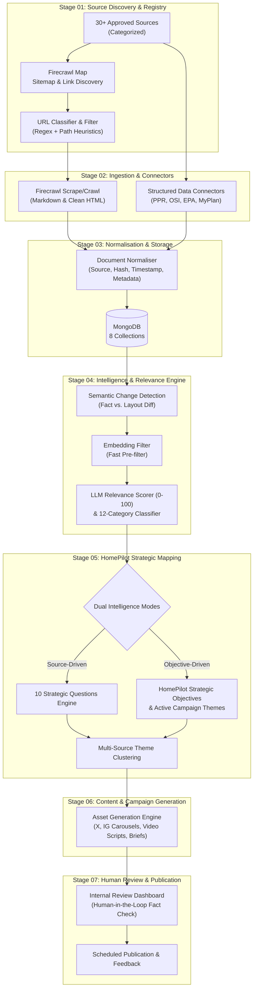
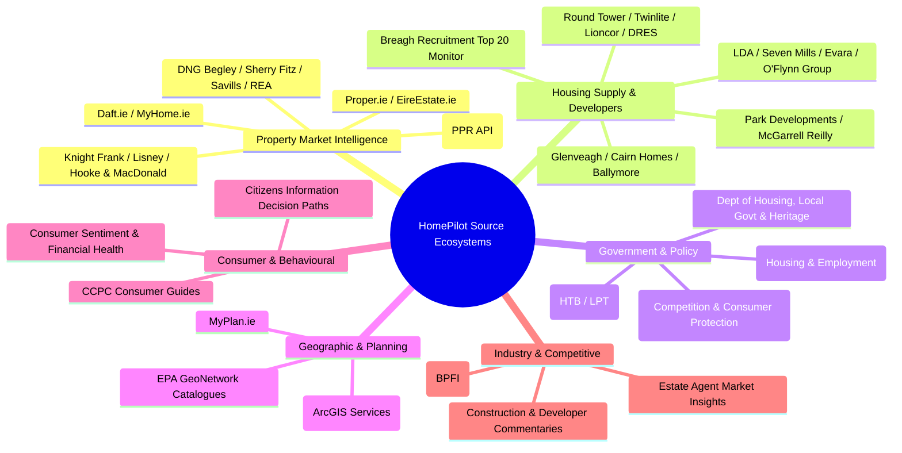
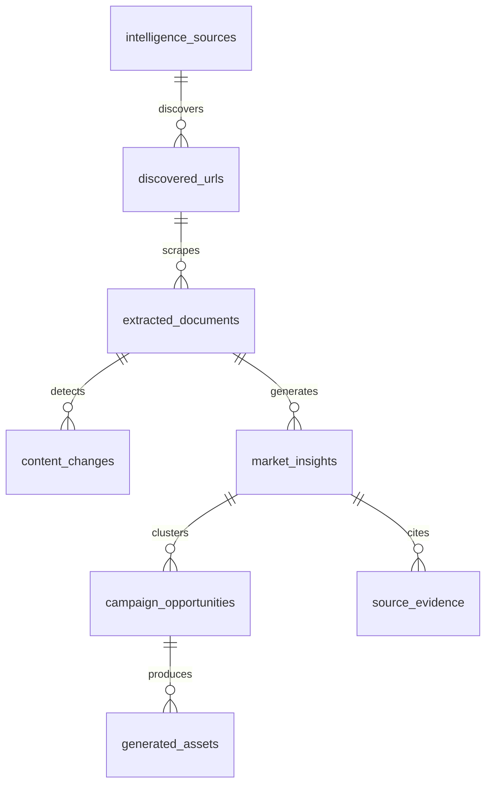
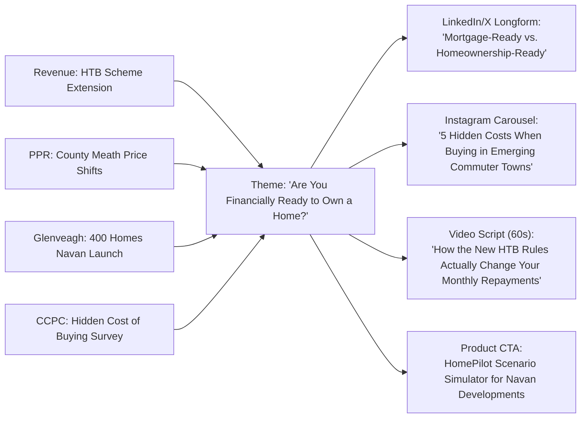
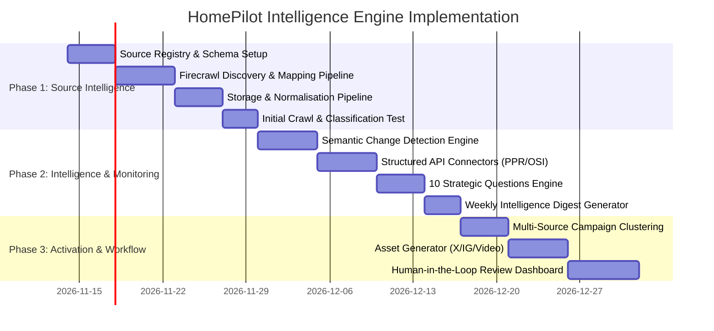

# HomePilot Market Intelligence Engine — Pipeline Architecture & Technical Specification

## 1. Architectural Philosophy: Pipeline Over Monolith

The **HomePilot Market Intelligence Engine** is engineered as a decoupled, multi-stage data and intelligence pipeline rather than a single monolithic AI agent. 



---

## 2. Dual-Engine Intelligence Model

| Paradigm | Trigger | Purpose | Example |
| :--- | :--- | :--- | :--- |
| **Source-Driven Intelligence** | Scheduled / Change Monitor | Identifies *what has changed* across registered sources. | Revenue modifies the Help to Buy (HTB) relief claim threshold. The pipeline flags the delta, scores its impact, and identifies affected buyers. |
| **Objective-Driven Intelligence** | Strategic Query / Campaign Need | Identifies *what HomePilot needs to prove, substantiate, or address*. | HomePilot runs a campaign on *"Mortgage-Ready vs. Homeownership-Ready"*. The engine proactively searches across recent PPR transactions, developer delivery schedules, and CCPC cost guides to compile an authoritative evidence packet. |

---

## 3. The 6 Intelligence Ecosystems & Approved Source Registry

Rather than treating all websites as uniform scrapers, sources are partitioned into distinct operational tiers:



### Source Ingestion Strategy & Cadence Table
| Ecosystem | Sources | Mode / Connector | Recommended Cadence | Key Intelligence Target |
| :--- | :--- | :--- | :--- | :--- |
| **Policy & Revenue** | Gov.ie Housing, Revenue.ie, CCPC, Citizens Information | Firecrawl Crawl / Monitor | **Daily (Every 24h)** | Scheme rule changes, grant criteria, tax relief adjustments, consumer rights |
| **Market Data** | Property Price Register | Direct Download / SQLite pipeline | **Weekly / On Release** | Transaction prices, county-by-county actuals, volume trends |
| **Market Listings** | Daft.ie, MyHome.ie, Major Agents | Firecrawl Map + Selective Crawl | **Daily / 12-Hour** | Asking price movements, quarterly report releases, new listings trends |
| **Supply & Developers** | Glenveagh, Cairn, Ballymore, LDA, Seven Mills, etc. | Firecrawl Crawl (Targeting `/developments`, `/news`) | **Daily** | New phase launches, planning applications, target delivery dates |
| **Geospatial & Planning** | MyPlan, OSI Open Data, EPA | ArcGIS REST APIs / GeoJSON downloads | **Weekly / Bi-weekly** | Zoning changes, infrastructural greenways, environmental designations |
| **Industry Research** | Breagh, SCSI, ESRI, BPFI | Firecrawl Scrape / RSS / Monitor | **Daily** | Supply forecasts, mortgage drawdown stats, economic commentary |

---

## 4. Two-Stage Semantic URL Discovery & Filtering

To avoid maintaining brittle URL lists (e.g., `/housing/mortgages/first-time-buyers`), the system operates a two-stage discovery loop:

### Stage A: Discovery & Structural Mapping (`Firecrawl Map`)
```typescript
// Example Node/Python wrapper invocation
const mapResult = await firecrawl.map("https://www.ccpc.ie/", {
  limit: 1000,
  sitemap: "include"
});
// Yields raw array of URLs: ['https://www.ccpc.ie/consumers/money/mortgages/...', ...]
```

### Stage B: Two-Tier Relevance Classification
1. **Tier 1 — Fast Path & Regex Filter**: Immediate elimination of non-relevant sections (`/careers`, `/privacy-policy`, `/cookie-notice`, `/buying-a-car`, etc.).
2. **Tier 2 — Semantic Classifier (Embedding / Fast LLM)**:
   > *"Does this document or page contain information that could materially influence the financial, behavioural, geographical, regulatory, or practical decisions involved in purchasing a home in Ireland?"*
   - Allows discovering hidden gems (e.g., `/consumer-credit/financial-difficulty` or `/budgeting/saving-deposit`) that lack the explicit keyword "mortgage".
3. **Execution**: Only URLs meeting the relevance threshold ($\ge 0.65$) proceed to deep markdown extraction via `firecrawl.scrape` or targeted `firecrawl.crawl`.

---

## 5. Storage Architecture (MongoDB Schema Design)

In alignment with HomePilot backend standards, the system employs 8 core collections:



### Collections Breakdown
1. **`intelligence_sources`**: Authoritative domain registry, source category, connector type (Firecrawl vs. API), schedule, and crawl headers.
2. **`discovered_urls`**: Inventory of all mapped URLs per source, discovery date, path depth, and tier-1/tier-2 relevance status.
3. **`extracted_documents`**: Clean markdown payload, parsed HTML metadata, content SHA-256 hash, publication date, and author.
4. **`content_changes`**: Diff log between document revisions. Strips layout/CSS changes and records semantic deltas only.
5. **`market_insights`**: Scored findings (0–100) mapped to the 12 categories, answering the 10 Strategic Questions.
6. **`source_evidence`**: Verifiable citations, quotes, data tables, and URL anchors backing every asserted fact.
7. **`campaign_opportunities`**: High-level campaign themes clustered across multiple insights (e.g., *"Are you financially ready to own a home?"*).
8. **`generated_assets`**: Ready-to-review marketing copy (X threads, IG carousels, video concepts, founder memos).

---

## 6. The 5 Strategic Dimensions & The 10 Strategic Questions

### The 5 HomePilot Strategic Dimensions
Every extracted insight is evaluated against:
1. **Financial Confidence**: Clarifies borrower standing, deposit requirements, stress-test calculations, and true ownership costs.
2. **Decision Intelligence**: Informs location selection, scheme trade-offs (e.g. HTB vs. Local Authority Home Loan), and fixed vs. variable choices.
3. **Reduced Uncertainty**: Eliminates bureaucratic jargon, timelines, closing-cost surprises, and conveyancing friction.
4. **Financial Outcomes**: Directly saves money, optimizes tax credits, prevents borrowing overreach, and maximizes equity retention.
5. **Homeownership Journey**: Bridges the chasm between "thinking about buying" (mortgage-ready) and "holding the keys" (homeownership-ready).

### The 10 Strategic Questions Evaluation Engine
For all items scoring $\ge 70$, the pipeline executes:
```text
1. What happened? (Objective factual statement)
2. Why does it matter? (Systemic impact on Irish market)
3. Who is affected? (First-time buyers, switchers, self-employed, Dublin vs. regional)
4. What customer problem does it relate to? (Deposit gap, approval delays, bidding wars)
5. How does it connect to HomePilot? (Positioning as the Homeownership OS)
6. Which product capability could help? (Mortgage Calculator, Borrowing Power Estimator, Scenario Planner)
7. Does it support an existing campaign? (Aligns with current content calendar)
8. Does it create a new campaign opportunity? (Spurs an immediate timely hook)
9. Is the information time-sensitive? (Immediate deadline vs. long-term trend)
10. What additional evidence is required? (Corroborating data from CSO, PPR, or Central Bank)
```

---

## 7. Multi-Source Intelligence-to-Asset Clustering

Rather than generating sporadic, noisy one-off social posts whenever an article changes, the engine groups related signals into **Thematic Intelligence Clusters**:



---

## 8. Phased Implementation Roadmap



### Phase Deliverables
* **Phase 1 Deliverable**: Working CLI & ingest pipeline running against the 30 approved URLs, cataloging discovered pages into MongoDB, and outputting clean markdown with relevance classification.
* **Phase 2 Deliverable**: Automated daily/weekly change monitoring, API ingestion of Property Price Register data, semantic diffing, and automated 0–100 relevance scoring with strategic answering.
* **Phase 3 Deliverable**: Thematic clustering engine generating review-ready social content, video briefs, and product tie-ins accessible via a review dashboard.
