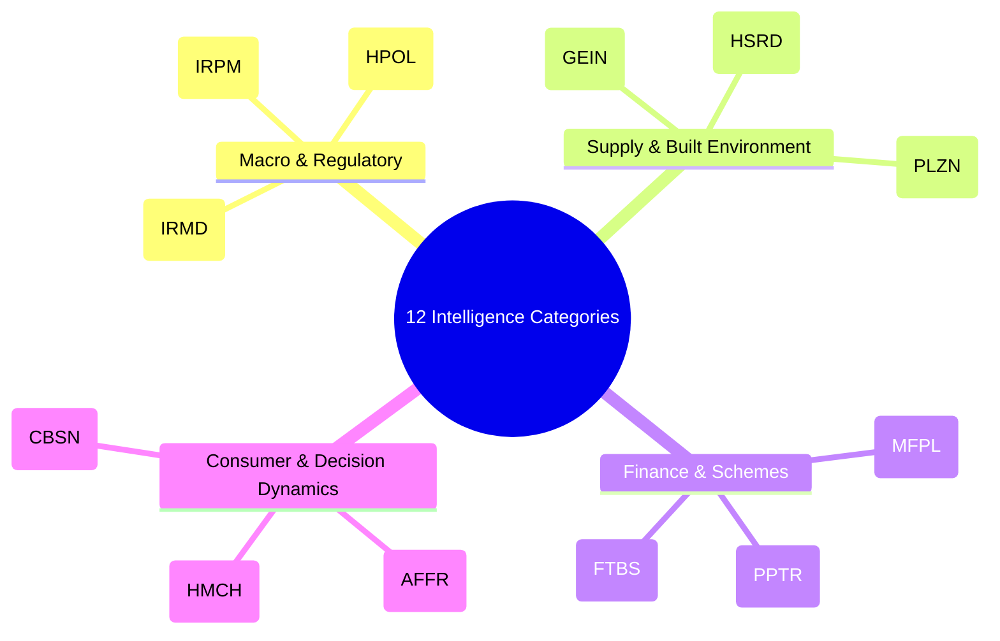
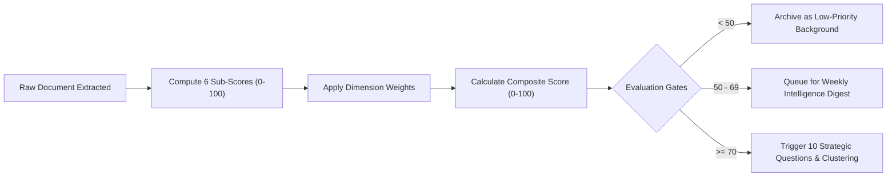
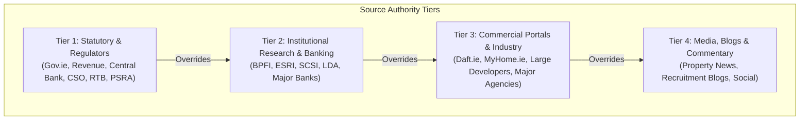
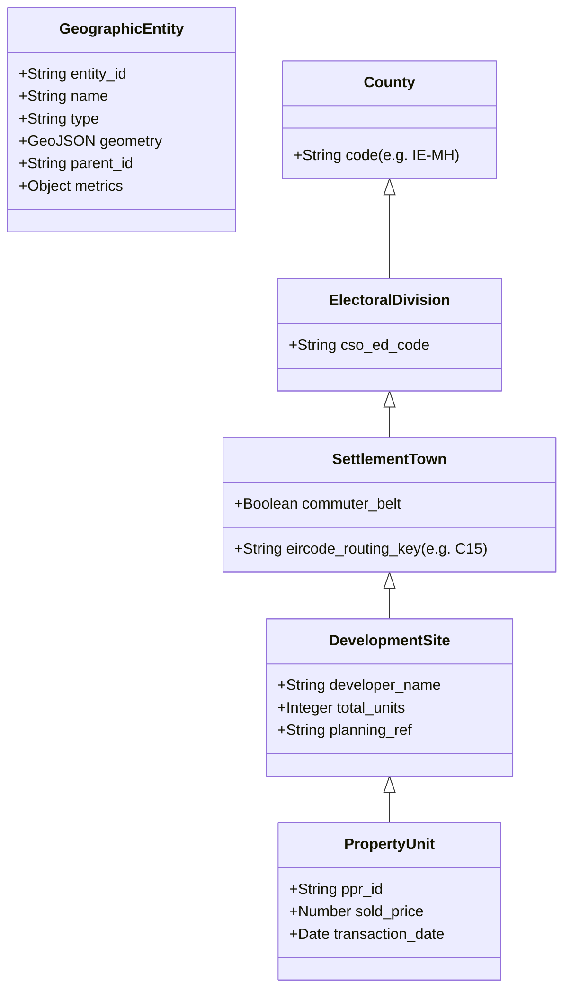
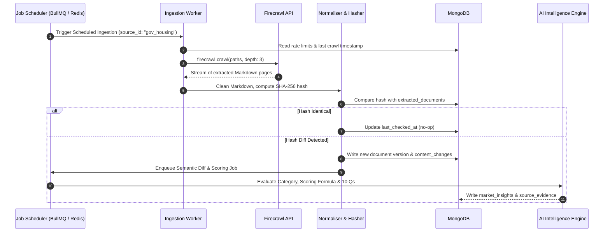

# HomePilot Market Intelligence Engine — Technical Implementation Specification

**Version:** 1.0.0-PROD-SPEC  
**Status:** Approved for Engineering Implementation  
**Audience:** Backend Engineers, Data Engineers, AI/ML Engineers  

---

## 1. The 12-Category Classification Taxonomy (v1.0)

To eliminate LLM drift and inconsistent categorization across worker turns, every incoming document or extracted insight is assigned a primary category and optional secondary tags from this strict, versioned taxonomy.



### Detailed Category Matrix

| Code | Category Name | Scope & Inclusion Criteria | Out-of-Scope (Disallowed) | Gold-Standard Example |
| :--- | :--- | :--- | :--- | :--- |
| **IRPM** | Irish Residential Property Markets | Macro market trends, nationwide/county asking price movements, housing market liquidity, aggregate listing volumes. | Micro individual listings, commercial office space, holiday rentals. | *Daft.ie / MyHome.ie Quarterly House Price Reports* |
| **HSRD** | Housing Supply & Residential Developments | Active and pipeline residential schemes, phase completions, developer launch schedules, construction delivery statistics. | Commercial/industrial developments, civil infrastructure. | *Glenveagh or Cairn Homes launch of 350 starter homes in Navan* |
| **MFPL** | Mortgage & Financial Planning | Central Bank macroprudential rules (LTI/LTV), lender interest rates (fixed/variable/green), stress-testing criteria, underwriting standards. | General commercial banking, business loans, personal credit cards. | *Central Bank review of macroprudential mortgage measures; AIB green mortgage rate cut* |
| **FTBS** | First-Time Buyer Schemes | Help to Buy (HTB), First Home Scheme (equity share), Local Authority Home Loan (LAHL), Vacant Property Refurbishment Grant. | Rental subsidies (HAP), social housing allocation lists. | *Revenue update on HTB qualification thresholds and relief claim caps* |
| **HPOL** | Housing Policy & Regulation | Government legislation, Housing for All targets, Land Development Agency mandates, Residential Tenancies Board rules, conveyancing reforms. | General political commentary without statutory/regulatory weight. | *Department of Housing policy paper updating cost-rental criteria* |
| **PPTR** | Property Prices & Transactions | Verified historical transaction data, sold price analysis, stamp duty records, asking vs. achieved price deltas. | Speculative price guesses without verified source citations. | *PPR transaction batch: 120 properties sold in Meath in Q3 2026* |
| **PLZN** | Planning & Zoning | Local Area Plans (LAPs), County Development Plans, Strategic Housing Developments (SHD/LRD), planning permissions and judicial reviews. | Routine non-residential individual renovations. | *An Bord Pleanála decision on 400 residential units in Clondalkin* |
| **GEIN** | Geography & Infrastructure | Transport routes (DART+, Luas extensions, bus corridors), school capacity, flood risk designations, water infrastructure (Uisce Éireann). | General tourism or non-residential transport updates. | *NTA announcement of commuter rail service expansion to Navan* |
| **CBSN** | Consumer Behaviour & Sentiment | Buyer survey data, changing preferences (e.g. WFH space vs. commute), bidding patterns, buyer demographics. | Generic consumer retail spending surveys. | *CCPC consumer survey on first-time buyer search duration and stress* |
| **HMCH** | Homeownership Challenges | Conveyancing delays, chain collapses, structural defect disclosures, legal friction points, bidding war transparency issues. | Generic grievances without market-level relevance. | *Law Society commentary on conveyancing turnaround times* |
| **AFFR** | Affordability & Financial Readiness | True cost of acquisition (legal, survey, stamp duty, valuation), deposit accumulation, debt-to-income hygiene, emergency buffer readiness. | Generic personal finance unrelated to property acquisition. | *BPFI analysis comparing median starter home prices to median household savings* |
| **IRMD** | Industry Research & Market Developments | Economic analyses by ESRI, SCSI, Central Bank, professional commentary on construction cost inflation and materials supply. | Promotional recruitment agency puff pieces without empirical data. | *SCSI Real Cost of New Housing Construction Report* |

---

## 2. Multidimensional Intelligence Scoring Methodology

The 0–100 score is not a subjective LLM generation. It is calculated via a deterministic, multi-attribute formula evaluated on six distinct sub-dimensions.



### The 6 Scoring Sub-Dimensions

$$\text{Intelligence Score} = \sum_{i=1}^{6} (w_i \times S_i)$$

Where $\sum w_i = 1.0$, defined as:

| Dimension ($S_i$) | Weight ($w_i$) | Meaning & Measurement Criteria |
| :--- | :--- | :--- |
| **1. HomePilot Strategic Relevance ($S_{\text{rel}}$)** | **0.25** | Alignment with HomePilot's 5 Strategic Pillars (reducing uncertainty, financial confidence, decision intelligence, financial outcomes, homeownership journey). |
| **2. Customer Financial Impact ($S_{\text{imp}}$)** | **0.25** | Magnitude of direct financial consequence to a prospective buyer (e.g., changes borrowing limit by $\ge €10,000$, affects grant of $\ge €30,000$, shifts monthly repayment). |
| **3. Evidence Confidence & Provenance ($S_{\text{conf}}$)** | **0.20** | Rigor and authority of the source (Statutory/Official = 100, Tier-2 Research/Banking = 80, Estate Agency = 60, Media Commentary = 40). |
| **4. Time Sensitivity & Actionability ($S_{\text{time}}$)** | **0.15** | Urgency: Deadlines (e.g., scheme expiry, rate change date, public consultation window, phase release registration date). |
| **5. Strategic Campaign Alignment ($S_{\text{camp}}$)** | **0.10** | Immediate overlap with active marketing themes (e.g., *"Mortgage-Ready vs. Homeownership-Ready"*). |
| **6. Geographic Specificity ($S_{\text{geo}}$)** | **0.05** | Precision of location data (National policy = 80, Specific County/Commuter town = 100, Undefined = 30). |

> [!IMPORTANT]
> **Strict Separation Rule**: Evidence Confidence ($S_{\text{conf}}$) is mathematically isolated from Business Relevance. An unconfirmed market rumor about an upcoming scheme change may have high Relevance ($S_{\text{rel}}=95$) but low Confidence ($S_{\text{conf}}=30$). The system logs it as an *unverified watch-item* rather than publishing assertions as established facts.

---

## 3. Evidence, Provenance & Conflict Resolution Engine

To maintain an auditable paper trail, sources are assigned hierarchical authority tiers. When two sources conflict, the system follows deterministic reconciliation rules.



### Conflict Resolution Protocols
1. **Rule of Direct Precedence**: If a Tier 1 source contradicts a Tier 3 source (e.g., a developer claims a home qualifies for a grant, but Revenue guidelines state it does not), the Tier 1 fact is declared authoritative, and a "Discrepancy Alert" is attached to the record.
2. **Temporal Precedence**: Within the same tier, the most recent verified publication timestamp takes precedence, archiving the older statement as a historical delta in `content_changes`.
3. **Evidence Requirement**: Every assertion stored in `market_insights` must populate `source_evidence_ids` linking to verbatim quotes, exact paragraph offsets, and raw source URLs in `source_evidence`.

---

## 4. Common Geographic Entity Model

To unify property transactions, developer releases, planning files, and environmental overlays, all spatial data is normalized to an **8-level hierarchical geographic entity model**:



### Integration Matrix for Geospatial Sources
| Source | Entity Level | Key Fields Extracted | Join Key |
| :--- | :--- | :--- | :--- |
| **Property Price Register** | Property / Town | Address, Sold Price, Date, New/Second-hand | Normalized Address + County + Eircode Key |
| **MyPlan.ie** | Development / Town | Zoning code (e.g., A1 Residential), LAP status | Local Authority Planning Ref / Cadastral ID |
| **OSI Open Data** | County / ED / Town | Administrative boundaries, Census population | CSO Geocode / GUID |
| **EPA GeoNetwork** | Development / Site | Flood zone (Zone A/B/C), water catchment | GeoJSON Polygon intersection |
| **Developer Portals** | DevelopmentSite | Unit count, launch date, pricing guidance | Site Name + Town + County |

---

## 5. MongoDB Database Schemas (Production Specifications)

All collections reside in the `homepilot_intelligence` database.

### 5.1 `intelligence_sources`
Master registry of approved domains, credentials, rate limits, and crawl configs.
```json
{
  "$jsonSchema": {
    "bsonType": "object",
    "required": ["source_id", "name", "root_url", "ecosystem", "tier", "connector_type", "cadence", "active"],
    "properties": {
      "source_id": { "bsonType": "string" },
      "name": { "bsonType": "string" },
      "root_url": { "bsonType": "string" },
      "ecosystem": { "enum": ["Property market intelligence", "Housing supply and development intelligence", "Government and policy intelligence", "Geographic and planning intelligence", "Consumer and behavioural intelligence", "Industry and competitive intelligence"] },
      "tier": { "enum": [1, 2, 3, 4] },
      "connector_type": { "enum": ["firecrawl", "api_or_dataset"] },
      "cadence": { "enum": ["hourly_12", "daily", "weekly", "on_release"] },
      "firecrawl_config": {
        "bsonType": "object",
        "properties": {
          "mode": { "enum": ["map", "crawl", "scrape"] },
          "max_depth": { "bsonType": "int" },
          "page_limit": { "bsonType": "int" },
          "include_paths": { "bsonType": "array", "items": { "bsonType": "string" } },
          "exclude_paths": { "bsonType": "array", "items": { "bsonType": "string" } }
        }
      },
      "rate_limit": {
        "bsonType": "object",
        "properties": {
          "requests_per_minute": { "bsonType": "int" },
          "respect_robots_txt": { "bsonType": "bool" }
        }
      },
      "last_crawled_at": { "bsonType": ["date", "null"] },
      "active": { "bsonType": "bool" }
    }
  }
}
```
*Indexes:* `{ source_id: 1 }` (Unique), `{ active: 1, cadence: 1 }`.

---

### 5.2 `discovered_urls`
Inventory of URLs found during mapping, with classification status.
```json
{
  "$jsonSchema": {
    "bsonType": "object",
    "required": ["url", "source_id", "discovered_at", "tier1_status", "semantic_score"],
    "properties": {
      "url": { "bsonType": "string" },
      "url_hash": { "bsonType": "string" },
      "source_id": { "bsonType": "string" },
      "discovered_at": { "bsonType": "date" },
      "path_depth": { "bsonType": "int" },
      "tier1_status": { "enum": ["approved", "rejected"] },
      "rejection_reason": { "bsonType": ["string", "null"] },
      "semantic_score": { "bsonType": "double" },
      "ingestion_status": { "enum": ["pending", "extracted", "failed", "skipped"] },
      "last_checked_at": { "bsonType": ["date", "null"] }
    }
  }
}
```
*Indexes:* `{ url_hash: 1 }` (Unique), `{ source_id: 1, ingestion_status: 1 }`, `{ semantic_score: -1 }`.

---

### 5.3 `extracted_documents`
Normalized raw text, markdown, content hashes, and structured metadata.
```json
{
  "$jsonSchema": {
    "bsonType": "object",
    "required": ["doc_id", "source_id", "url", "content_hash", "retrieved_at", "markdown"],
    "properties": {
      "doc_id": { "bsonType": "string" },
      "source_id": { "bsonType": "string" },
      "url": { "bsonType": "string" },
      "title": { "bsonType": "string" },
      "published_at": { "bsonType": ["date", "null"] },
      "retrieved_at": { "bsonType": "date" },
      "content_hash": { "bsonType": "string" },
      "markdown": { "bsonType": "string" },
      "http_status": { "bsonType": "int" },
      "author": { "bsonType": ["string", "null"] },
      "version": { "bsonType": "int" },
      "is_active": { "bsonType": "bool" }
    }
  }
}
```
*Indexes:* `{ doc_id: 1 }` (Unique), `{ url: 1, version: -1 }`, `{ content_hash: 1 }`.

---

### 5.4 `content_changes`
Semantic deltas between document revisions, filtering out formatting noise.
```json
{
  "$jsonSchema": {
    "bsonType": "object",
    "required": ["change_id", "doc_id", "detected_at", "change_type", "semantic_delta"],
    "properties": {
      "change_id": { "bsonType": "string" },
      "doc_id": { "bsonType": "string" },
      "url": { "bsonType": "string" },
      "detected_at": { "bsonType": "date" },
      "previous_hash": { "bsonType": "string" },
      "current_hash": { "bsonType": "string" },
      "change_type": { "enum": ["fact_change", "policy_revision", "pricing_update", "date_change", "trivial_layout"] },
      "semantic_delta": {
        "bsonType": "object",
        "properties": {
          "summary": { "bsonType": "string" },
          "added_facts": { "bsonType": "array", "items": { "bsonType": "string" } },
          "removed_facts": { "bsonType": "array", "items": { "bsonType": "string" } },
          "numeric_deltas": { "bsonType": "array" }
        }
      },
      "processed_for_insights": { "bsonType": "bool" }
    }
  }
}
```
*Indexes:* `{ change_id: 1 }` (Unique), `{ doc_id: 1, detected_at: -1 }`, `{ processed_for_insights: 1 }`.

---

### 5.5 `source_evidence`
Direct verifiable quotations, data rows, tables, and URL anchors.
```json
{
  "$jsonSchema": {
    "bsonType": "object",
    "required": ["evidence_id", "doc_id", "source_url", "claim", "verbatim_quote", "confidence_tier"],
    "properties": {
      "evidence_id": { "bsonType": "string" },
      "doc_id": { "bsonType": "string" },
      "source_url": { "bsonType": "string" },
      "claim": { "bsonType": "string" },
      "verbatim_quote": { "bsonType": "string" },
      "data_points": { "bsonType": "object" },
      "confidence_tier": { "enum": [1, 2, 3, 4] },
      "verified_by_human": { "bsonType": "bool" },
      "created_at": { "bsonType": "date" }
    }
  }
}
```
*Indexes:* `{ evidence_id: 1 }` (Unique), `{ doc_id: 1 }`.

---

### 5.6 `market_insights`
Scored intelligence answering the 10 Strategic Questions.
```json
{
  "$jsonSchema": {
    "bsonType": "object",
    "required": ["insight_id", "primary_category", "composite_score", "ten_questions", "evidence_ids"],
    "properties": {
      "insight_id": { "bsonType": "string" },
      "doc_id": { "bsonType": "string" },
      "primary_category": { "bsonType": "string" },
      "secondary_tags": { "bsonType": "array", "items": { "bsonType": "string" } },
      "geographic_entities": { "bsonType": "array", "items": { "bsonType": "string" } },
      "scoring": {
        "bsonType": "object",
        "properties": {
          "composite_score": { "bsonType": "double" },
          "s_relevance": { "bsonType": "double" },
          "s_impact": { "bsonType": "double" },
          "s_confidence": { "bsonType": "double" },
          "s_time_sensitivity": { "bsonType": "double" },
          "s_campaign_alignment": { "bsonType": "double" },
          "s_geography": { "bsonType": "double" }
        }
      },
      "ten_questions": {
        "bsonType": "object",
        "properties": {
          "q1_what_happened": { "bsonType": "string" },
          "q2_why_it_matters": { "bsonType": "string" },
          "q3_who_is_affected": { "bsonType": "string" },
          "q4_customer_problem": { "bsonType": "string" },
          "q5_homepilot_connection": { "bsonType": "string" },
          "q6_product_capability": { "bsonType": "string" },
          "q7_supports_existing_campaign": { "bsonType": "string" },
          "q8_creates_new_campaign": { "bsonType": "string" },
          "q9_time_sensitivity": { "bsonType": "string" },
          "q10_additional_evidence_needed": { "bsonType": "string" }
        }
      },
      "evidence_ids": { "bsonType": "array", "items": { "bsonType": "string" } },
      "status": { "enum": ["candidate", "clustered", "archived"] },
      "created_at": { "bsonType": "date" }
    }
  }
}
```
*Indexes:* `{ insight_id: 1 }` (Unique), `{ "scoring.composite_score": -1 }`, `{ primary_category: 1 }`, `{ status: 1 }`.

---

### 5.7 `campaign_opportunities`
Multi-source thematic clusters mapped to HomePilot commercial objectives.
```json
{
  "$jsonSchema": {
    "bsonType": "object",
    "required": ["campaign_id", "theme_title", "central_customer_problem", "insight_ids", "status"],
    "properties": {
      "campaign_id": { "bsonType": "string" },
      "theme_title": { "bsonType": "string" },
      "strategic_dimension": { "enum": ["financial_confidence", "decision_intelligence", "reduced_uncertainty", "financial_outcomes", "homeownership_journey"] },
      "central_customer_problem": { "bsonType": "string" },
      "homepilot_positioning_hook": { "bsonType": "string" },
      "product_feature_cta": { "bsonType": "string" },
      "insight_ids": { "bsonType": "array", "items": { "bsonType": "string" } },
      "status": { "enum": ["draft", "ready_for_review", "approved", "published", "rejected"] },
      "created_at": { "bsonType": "date" }
    }
  }
}
```
*Indexes:* `{ campaign_id: 1 }` (Unique), `{ status: 1 }`, `{ strategic_dimension: 1 }`.

---

### 5.8 `generated_assets`
Draft content assets awaiting human approval.
```json
{
  "$jsonSchema": {
    "bsonType": "object",
    "required": ["asset_id", "campaign_id", "asset_type", "content_payload", "review_status"],
    "properties": {
      "asset_id": { "bsonType": "string" },
      "campaign_id": { "bsonType": "string" },
      "asset_type": { "enum": ["x_thread", "instagram_carousel", "short_form_video_script", "strategic_brief"] },
      "content_payload": {
        "bsonType": "object",
        "properties": {
          "headline": { "bsonType": "string" },
          "copy_body": { "bsonType": "string" },
          "carousel_slides": { "bsonType": "array" },
          "video_storyboard": { "bsonType": "array" },
          "evidence_citations": { "bsonType": "array", "items": { "bsonType": "string" } }
        }
      },
      "review_status": { "enum": ["pending_review", "approved", "revisions_requested", "rejected"] },
      "reviewer_notes": { "bsonType": ["string", "null"] },
      "reviewed_by": { "bsonType": ["string", "null"] },
      "scheduled_publish_time": { "bsonType": ["date", "null"] },
      "created_at": { "bsonType": "date" }
    }
  }
}
```
*Indexes:* `{ asset_id: 1 }` (Unique), `{ campaign_id: 1 }`, `{ review_status: 1 }`.

---

## 6. Operational Infrastructure & Job Orchestration



### Key Operational Policies
1. **Idempotency**: All ingestion tasks use a deterministic hash key `md5(url + content_sha256)`. Repeated runs on unmodified pages generate zero database writes and zero downstream LLM tokens.
2. **Rate Limiting & Robots.txt Compliance**:
   - Commercial Portals (Daft, MyHome): Enforced 5 requests/minute with random backoff, strictly observing robots exclusion directives.
   - Government Portals: Enforced 15 requests/minute.
3. **Dead-Letter Queue (DLQ)**: Any crawler timeout or extraction parsing failure retries 3 times with exponential backoff ($2^n \times 10\text{s}$) before moving to `dead_letter_extractions` with alerting.
4. **Token Cost Accounting**: Every LLM evaluation call logs prompt tokens, completion tokens, model name, and execution duration in an audit collection.

---

## 7. Performance & Feedback Telemetry Engine

Closing the loop: connecting marketing engagement and customer interactions back to the intelligence engine.


### Telemetry Payload Schema
```json
{
  "event_id": "evt_987654",
  "campaign_id": "cmp_navan_ftb_2026",
  "asset_id": "ast_carousel_01",
  "channel": "instagram",
  "metrics": {
    "impressions": 14200,
    "saves": 380,
    "shares": 195,
    "calculator_link_clicks": 620,
    "completed_scenarios": 145
  },
  "feedback_insight": "High conversion on question of stamp duty vs. legal fees. Elevate AFFR category weighting for County Meath.",
  "timestamp": "2026-11-13T12:45:00Z"
}
```

---

## 8. Phase 1 Acceptance Criteria & Verification Plan

Before advancing to Phase 2 (Change Detection & Strategic Answering), the Phase 1 build must pass four non-negotiable acceptance tests:

| Test ID | Test Name | Validation Scenario | Success Criteria |
| :--- | :--- | :--- | :--- |
| **TC-01** | **Source Registry Integrity** | Ingest all 34 sources from `config/sources_registry.json`. | 100% of sources successfully registered in MongoDB with valid rate limits and schemas. |
| **TC-02** | **Two-Stage Discovery Filter** | Execute Firecrawl Map against CCPC (`ccpc.ie`). | Identifies $\ge 150$ URLs; Tier 1 heuristics successfully reject `/buying-a-car` and `/privacy`; Tier 2 semantic filter approves `/consumer-credit/financial-difficulty`. |
| **TC-03** | **Idempotent Storage & Hashing** | Crawl a sample target twice consecutively with 0 modifications. | First run creates `extracted_documents` records; second run generates **0 duplicate documents**, updates `last_checked_at`, and triggers 0 LLM calls. |
| **TC-04** | **12-Category Classification Accuracy** | Run classifier against 20 pre-curated test articles across the 12 categories. | $\ge 90\%$ accuracy against the gold-standard manual classification benchmark. |
