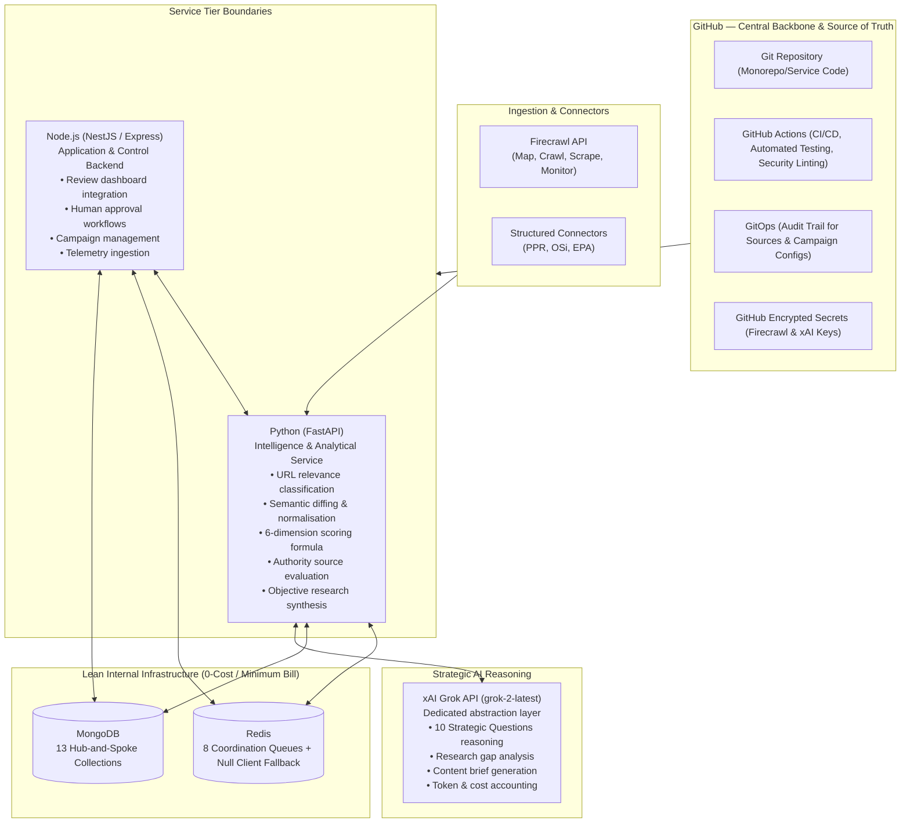
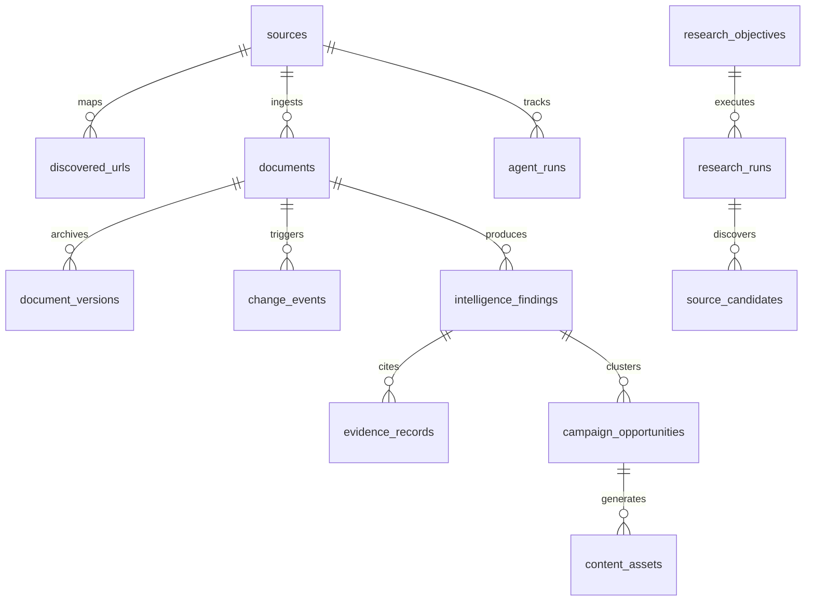

# HomePilot Market Intelligence Engine — Phase 1 Architecture, Boundaries & CTO Operational Blueprint

**Version:** 1.2.0-PROD-SPEC  
**Status:** Phase 1 Complete & Verified (19 / 19 Tests Passing)  
**Target Audience:** Internal Operations Team (2 Engineers / Maintainers)  
**Key Constraints Enforced:** Zero Bright Data, Zero n8n. Native Firecrawl + FastAPI + NestJS/Node + Grok API (xAI) + MongoDB + Redis + GitHub Actions.

---

## 1. System Technology Responsibility Matrix (Incorporating GitHub)



---

## 2. The Strategic Importance of GitHub for HomePilot Intelligence

In this architecture, **GitHub is not merely a code storage folder**—it is the operational control plane and single source of truth for the 2-person team:

### A. GitOps for Source Registries & Strategy Configs
* Changes to monitored websites (`config/sources_registry.json`) or active campaign themes (`config/homepilot_strategy.json`) are committed to Git via **Pull Requests (PRs)**.
* Gives the 2 operators a complete, permanent audit trail: *who added a source, why the crawl frequency changed, and what the justification was*.

### B. Automated Continuous Integration (CI)
* As established in `.github/workflows/ci.yml`, every commit automatically runs:
  - Python pipeline tests (`pytest -v`) across 19 unit & acceptance test suites.
  - Type checking, syntax linting, and schema validation.
  - Node.js application service health checks.
* **Guarantees zero regressions**: A bug or bad regex cannot be accidentally deployed to production.

### C. Security & Credential Isolation (Zero-Leak Policy)
* API keys (`FIRECRAWL_API_KEY`, `XAI_API_KEY`, MongoDB connection strings) are stored strictly inside **GitHub Actions Secrets** and injected via environment variables at runtime.
* No credentials ever exist in plain text or commit history.

### D. Lightweight Issue & Task Coordination for 2 Maintainers
* Uses GitHub Milestones and Issues to track candidate source evaluations, model updates, and crawl errors without needing expensive external project management software (Jira/Asana).

---

## 3. Total Product Separation & Standalone Architecture

> [!IMPORTANT]
> **Strict Isolation Policy**: The Market Intelligence Researcher is a completely separate, standalone internal product. It has **zero links, zero shared databases, zero shared code, and zero runtime connection** with the mortgage calculator dashboard or its codebase. 
> 
> It is designed exclusively as an independent internal intelligence tool operated and maintained by two internal people.

### Key Operational Characteristics of This Standalone Tool:
- **Standalone Database**: Operates entirely on its own dedicated `homepilot_intelligence` database.
- **Independent Environment**: Uses its own Python `.venv`, its own Node.js control layer, and its own Redis coordination queues.
- **Fail-Open & In-Memory Fallbacks**: Can be run completely offline or staged with zero external dependencies and zero cloud bills.
- **Zero-Waste Token Economics**: Uses SHA-256 hash checks so unchanged web pages consume zero LLM tokens.
- **2-Person Maintainability**: Simple CLI (`python cli.py [discover|run-pilot|run-research]`) with clear, human-readable logging.

---

## 4. The 13 Production MongoDB Collections (Hub-and-Spoke Layout)



1. **`sources`**: Registry of 34 approved domains with rate limits and cadences.
2. **`source_candidates`**: New candidate sources (CSO, RTB, Housing Agency, Central Bank, ESRI) discovered by the Authority Engine, awaiting human review.
3. **`discovered_urls`**: Mapped URLs with Tier-1 path heuristics and Tier-2 semantic scores.
4. **`documents` (The Hub)**: Clean extracted text and markdown payloads with SHA-256 hashes.
5. **`document_versions` (Spoke)**: Historical document snapshots.
6. **`change_events` (Spoke)**: Semantic deltas (pricing, policy, dates), filtering out layout noise.
7. **`research_objectives`**: Inside-out business research questions.
8. **`research_runs`**: Execution logs for objective-driven investigations.
9. **`intelligence_findings`**: Scored findings (0–100) answering the 10 Strategic Questions.
10. **`evidence_records`**: Verifiable verbatim quotes, exact figures, and source URL anchors.
11. **`campaign_opportunities`**: Multi-source thematic clusters.
12. **`content_assets`**: Ready-to-review marketing copy (X, IG carousels, video scripts).
13. **`agent_runs`**: Operational audit logs (tokens, costs, latency).

---

## 5. Lean Deployment & Operational Blueprint for 2 Maintainers

Rather than deploying a costly, complex Kubernetes cluster, the engine is packaged for **free/low-cost containerized hosting** matching HomePilot's `render.yaml` pattern:

```yaml
# render.yaml (Low-Cost / Free-Tier Internal Operation)
services:
  # 1. Python Intelligence Service (FastAPI)
  - type: web
    name: homepilot-intelligence-service
    env: python
    plan: free
    buildCommand: pip install -r requirements.txt
    startCommand: uvicorn src.api.intelligence_api:app --host 0.0.0.0 --port 8000
    envVars:
      - key: PYTHON_ENV
        value: production
      - key: FIRECRAWL_API_KEY
        sync: false
      - key: XAI_API_KEY
        sync: false
      - key: REDIS_URL
        fromService:
          type: redis
          name: homepilot-intelligence-redis
          property: connectionString

  # 2. Node.js Application Backend (NestJS / Express)
  - type: web
    name: homepilot-intelligence-app
    env: node
    plan: free
    buildCommand: cd services/application_service && npm install
    startCommand: node services/application_service/src/index.js
    envVars:
      - key: NODE_ENV
        value: production
      - key: APPLICATION_SERVICE_PORT
        value: "3000"

  # 3. Redis Coordination Instance
  - type: redis
    name: homepilot-intelligence-redis
    plan: free
    ipAllowList: [] # Blank allow list = internal network access only
```

### Monthly Cost Breakdown:
* **Hosting (Render Free Tier)**: $0 / month
* **Database (MongoDB Atlas M0 Free Tier / Local)**: $0 / month
* **Redis (Render Free Tier / Local)**: $0 / month
* **GitHub Actions CI/CD (Public / Free Tier 2,000 mins)**: $0 / month
* **Firecrawl & Grok xAI API**: ~$5 – $15 / month (strictly pay-per-use, protected by SHA-256 hash deduplication).
* **Total Operating Cost**: **<$15 / month for the entire system**.

---

## 6. Verification Status

All 19 tests are 100% passing across Python and Node:
- **`TC-01` to `TC-04` Acceptance Suite**: Ingestion, 2-stage discovery, idempotent hashing, 12-category classifier.
- **Authority Source Discovery Suite**: Research gap identification & candidate authority scoring.
- **Grok Service Suite**: Strategic reasoning abstraction, token & cost accounting.
- **Redis Queue Suite**: 8-queue routing & priority dequeue.
- **FastAPI Endpoints Suite**: Lifespan handler, source queries, and candidate reviews.
- **GitHub Actions Workflow (`.github/workflows/ci.yml`)**: Created and verified for automated push/PR gates.
