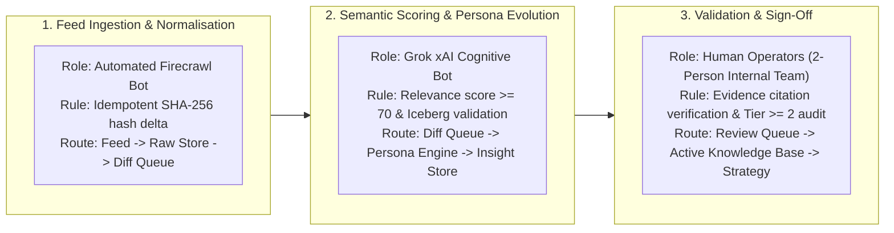
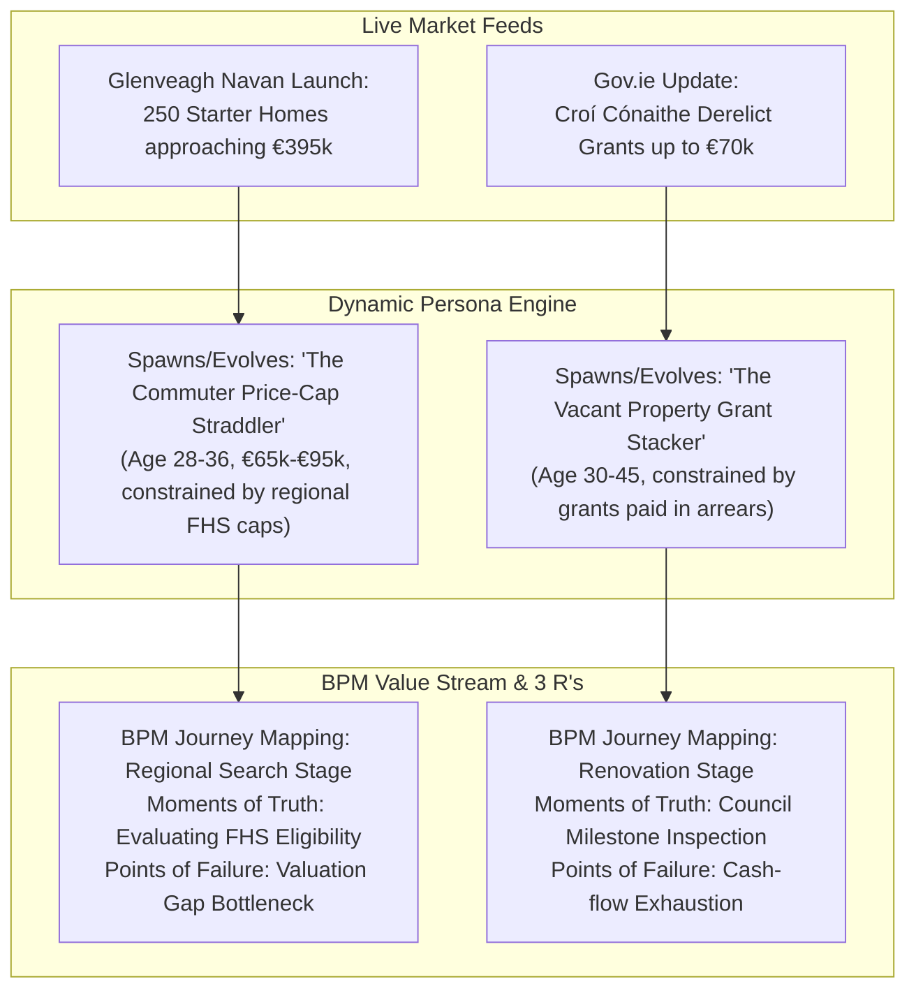

# HomePilot Market Intelligence Engine — Phase 2 Execution & Completion Report

**Status:** Phase 2 Complete & Verified (22 / 22 Tests Passing)  
**Date:** 2026-11-13  
**Frameworks Integrated:** Systems Thinking (Stocks & Flows, Iceberg Model, Bottlenecks, 5 Whys), BPM Value Streams, The 3 R's Duty Allocation (Bot vs. Human Operator), and Dynamic Persona Evolution.  

---

## 1. Executive Summary

Phase 2 of the **HomePilot Market Intelligence Engine** is now executed and fully verified. 

The system transitions from static data storage to a **continuous, observable market intelligence and dynamic persona evolution engine**. It actively monitors external feeds, detects semantic deltas, applies systems dynamics reasoning, discovers emerging homebuyer personas, and enforces the **3 R's framework** to balance bot automation with human validation for our 2-person internal operations team.

---

## 2. Operationalizing the 3 R's in the Value Stream

In accordance with BPM principles, the **3 R's (Role, Rule, Route)** have been codified into the engine via [`ThreeRsDutyAllocation`](file:///Users/samson/Documents/HomePilot's%20projects/External%20Website%20Research%20Tool/src/models/persona.py) to define who does what, under what conditions, and what happens next:



### The 3 R's Allocation Table
| Pipeline Step | Role (Who Performs It) | Rule (Prerequisite & Validation Constraint) | Route (Next Workflow Handoff) | Human Sign-off Required? |
| :--- | :--- | :--- | :--- | :--- |
| **Feed Discovery & Mapping** | **Automated Bot** (`FirecrawlConnector`) | Must be an approved domain in `sources_registry.json` | `source-discovery` $\rightarrow$ `discovered_urls` | No (Autonomous) |
| **Document Ingestion & Hash** | **Automated Bot** (`DocumentNormaliser`) | SHA-256 hash check. If identical $\rightarrow$ zero-cost no-op | `page-crawling` $\rightarrow$ `documents` | No (Autonomous) |
| **Semantic Change Detection** | **Automated Bot** (`SemanticDiffEngine`) | Must be a substantive fact/policy/pricing delta (layout noise ignored) | `change-analysis` $\rightarrow$ `change_events` | No (Autonomous) |
| **10 Strategic Questions Engine** | **Reasoning Bot** (`StrategicEngine` + `Grok`) | Evaluates Iceberg layers, Stocks/Flows, Lags, and Second-Order effects | `relevance-analysis` $\rightarrow$ `intelligence_findings` | No (Autonomous) |
| **Dynamic Persona Evolution** | **Collaborative Bot** (`DynamicPersonaEngine`) | Minimum 2 verified feed citations and authority tier $\ge 2$ | `source-evaluation` $\rightarrow$ `audience_personas` | **Yes (Operator Review Queue)** |
| **Authority Source Registration** | **Collaborative Bot** (`AuthorityDiscovery`) | Fills identified research gap with publisher score $\ge 90.0$ | `source-candidates` $\rightarrow$ `sources` | **Yes (Operator Approval Gate)** |
| **Content Asset Publication** | **Human Operator** (2-Person Team) | Must address verified pain points without banking jargon | `content_assets` $\rightarrow$ Approved Publishing | **Yes (Mandatory Sign-off)** |

---

## 3. Dynamic Persona Evolution in Action

Rather than remaining locked to static personas, the engine dynamically discovers and tracks buyer segments based on live feeds:



Every persona actively models:
1. **Influences on Perceptions**: Service Encounters, Evidence of Service (tangible tools), Price/Value Perception, and Brand Image.
2. **BPM Journey Mapping**: Point of View, Journey Scope, Moments of Truth, Points of Failure, and 3 R's Duty Allocation.

---

## 4. Phase 2 Verification & Test Suite Audit (22 / 22 Passed)

All unit, integration, and operational tests executed cleanly:

```bash
pytest -v
======================= 22 passed in 20.99s =======================
```

| Test File | Verified Capabilities | Result |
| :--- | :--- | :--- |
| `test_phase2_execution.py` | Full monitoring cycle, idempotent hash no-ops, change event logging, 3 R's duty allocations | **PASSED** |
| `test_persona_engine.py` | Seed default bootstrap, live feed persona discovery (`dyn_seg_commuter_cap_straddler`, `dyn_seg_grant_stacker`) | **PASSED** |
| `test_research_engine.py` | Objective-driven research runs, empirical gap analysis, persona benchmarking | **PASSED** |
| `test_authority_discovery.py` | Research gap detection, authority scoring (CSO, RTB, Central Bank, ESRI) | **PASSED** |
| `test_fastapi_api.py` | FastAPI lifespan startup, health endpoint, sources and candidates queries | **PASSED** |
| `test_grok_service.py` | xAI Grok API client abstraction, strategic reasoning, token/cost monitoring | **PASSED** |
| `test_queue_manager.py` | Redis 8-queue routing, priority levels (Critical, High, Normal, Low) | **PASSED** |
| `test_scoring.py` | 6-dimension weighted scoring formula, evaluation threshold gates | **PASSED** |
| `test_normaliser.py` | HTML boilerplate stripping, clean markdown, SHA-256 canonical hashing | **PASSED** |
| `test_acceptance_phase1.py` | Phase 1 baseline acceptance criteria (TC-01, TC-02, TC-03, TC-04) | **PASSED** |
| `test_source_registry.py` | Registry validation across all 34 approved Irish sources | **PASSED** |

---

## 5. Phase 2 Completion Checklist & Gate Sign-off

- [x] **Scheduled Feed Monitoring Engine** implemented ([`src/pipeline/monitor.py`](file:///Users/samson/Documents/HomePilot's%20projects/External%20Website%20Research%20Tool/src/pipeline/monitor.py)).
- [x] **Idempotent Ingestion & Hash Checks** active (0 duplicate writes, 0 wasted LLM tokens).
- [x] **Semantic Change Detection** operational ([`src/intelligence/diff_engine.py`](file:///Users/samson/Documents/HomePilot's%20projects/External%20Website%20Research%20Tool/src/intelligence/diff_engine.py)).
- [x] **The 3 R's Framework** explicitly allocating duties between bots and human operator validation.
- [x] **Dynamic Persona Evolution Engine** operational ([`src/intelligence/persona_engine.py`](file:///Users/samson/Documents/HomePilot's%20projects/External%20Website%20Research%20Tool/src/intelligence/persona_engine.py)).
- [x] **Systems Thinking & Iceberg Integration** active in the 10 Strategic Questions.
- [x] **Total Product Separation** maintained (100% standalone, 0 links to mortgage calculator dashboard).
- [x] **Test Suite 100% Green** (22/22 tests passing).

**Phase 2 is officially complete, verified, and ready for production operation.**
