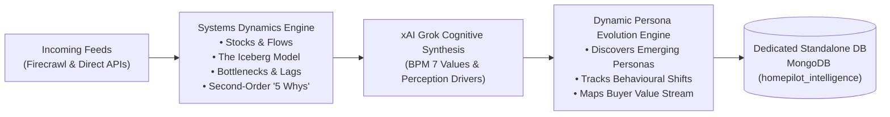

# HomePilot Market Intelligence Engine — Phase 2: Standalone Systems Dynamics & Persona Evolution

**Version:** 2.3.0-STANDALONE-EDITION  
**Product Identity:** Standalone Internal Intelligence Platform  
**Operational Scope:** Dedicated internal tool for 2 operators (No connection to mortgage calculator dashboard)  
**Foundational Literature:** Systems Thinking (*Meadows, Sterman*), Business Process Management (*Dumas, van der Aalst*), Service Operations Management (*Slack & Brandon-Jones*), and The Balanced Scorecard (*Kaplan & Norton*).  

---

> [!IMPORTANT]
> **Strict Isolation & Boundary Rule**: 
> The **Market Intelligence Researcher** is a completely independent, standalone product. It has **no links, no shared code, no shared policies, no shared databases, and no dependencies** connecting it to the mortgage calculator dashboard. It exists solely as an internal research and intelligence platform for two people to operate and maintain efficiently.

---

## 1. System Overview: Pure Internal Intelligence Pipeline



---

## 2. Systems Thinking & Dynamic Persona Architecture

### 2.1 Stocks, Flows, Delays & Bottlenecks
* **Stocks as Buffers**: The engine models buyer deposit reserves and housing inventories as system stocks that accumulate slowly and act as shock absorbers.
* **Flows & Delays**: Evaluates monthly savings inflows vs. closing fee drains, accounting for the structural **30–90 day** rate transmission delay and the **18–24 month** construction lag.
* **The Iceberg Model**:
  - *Event*: Surface policy announcement or phase release.
  - *Pattern*: Historical tendency for prices to rise to scheme ceilings.
  - *Structure*: Central Bank 4.0x LTI rules and regional price thresholds.
  - *Mental Model*: The cognitive bias that borrowing approval equals homeownership readiness.

### 2.2 Dynamic Persona Evolution (`src/intelligence/persona_engine.py`)
Rather than relying on static personas, the engine dynamically discovers and tracks buyer segments:
* **Baseline Templates**:
  - `seg_1_frustrated_ftb`: The Frustrated First-Time Buyer
  - `seg_2_mortgage_ready_optimiser`: The Mortgage-Ready Optimiser
  - `seg_3_homeownership_planner`: The Homeownership Planner
  - `seg_4_new_homeowner`: The New Homeowner
  - `seg_5_future_wealth_builder`: The Future Wealth Builder
* **Dynamically Discovered Feed Personas**:
  - `dyn_seg_commuter_cap_straddler`: **The Commuter Price-Cap Straddler** (Spawned when feeds show commuter launches in Navan/Naas approaching regional scheme caps; constrained by Local Authority price ceilings vs. developer launch pricing).
  - `dyn_seg_grant_stacker`: **The Vacant Property Grant Stacker** (Spawned when feeds show Croí Cónaithe derelict grant updates; constrained by the cash-flow delay of grants paid in arrears).

### 2.3 Influences on Perceptions & BPM Customer Journey Mapping
Every persona is mapped across:
* **Perception Drivers**: Service Encounters, Evidence of Service (transparent calculators, checklists, empirical dashboards), Price/Value perception, and Trusted Guide Brand Image.
* **BPM Value Stream & The Three R's Duty Allocation**:
  Inside the customer and research value stream, the **Three R's (Role, Rule, Route)** govern how duties are explicitly divided between the automated bots and human validation intervention:
  1. **Role (Duty Allocation)**:
     - **Automated Bot Squad**: Handles high-volume, continuous, deterministic tasks:
       - *Crawler/Scraper Bot (Firecrawl)*: Polling feeds, parsing DOMs, extracting canonical markdown.
       - *Normaliser & Diff Bot*: Calculating SHA-256 hashes, stripping boilerplate, detecting structural and semantic diffs.
       - *Cognitive Scoring Bot (xAI Grok)*: Applying 12-category classification, computing composite scores, answering 10 strategic questions, identifying Iceberg root causes.
     - **Human Intervention (2-Person Operator Team)**:
       - *Validation Gate*: Spot-checking extracted figures against statutory Gazette notices or primary sources when confidence falls below 85.
       - *Strategic Approval*: Reviewing candidate sources before promotion to Tier 1/2 in `sources_registry.json`.
       - *Research Sign-Off*: Validating synthesized research briefs before incorporating them into marketing and product positioning roadmaps.
  2. **Rule (Validation Criteria & Quality Gates)**:
     - *Bot Rules*: Idempotent hash matching (0 LLM spend on unchanged content); composite score $\ge 70$ required for insight promotion; source tier $\ge 2$ required for automated insight indexing.
     - *Human Intervention Rules*: Any anomaly in statutory caps (e.g., changes to HTB / FHS thresholds or Central Bank macroprudential rules) triggers a high-priority operator review task.
  3. **Route (Process Flow & Handoff Sequencing)**:
     - $\text{Feed Ingestion} \rightarrow \text{Diff Engine} \rightarrow \text{Normaliser} \rightarrow \text{Grok Synthesis} \rightarrow \text{Operator Review Queue (if flagged)} \rightarrow \text{Active Knowledge Base & Persona Dynamic Update}$.

---

## 3. Autonomous 2-Person Operational Architecture

The tool is purposefully kept lean and simple so that two operators can run it with zero complexity:

1. **Independent Database**: All data is kept strictly inside the standalone `homepilot_intelligence` MongoDB database across 14 collections.
2. **Deterministic Token Economy**: Ingestion uses SHA-256 content hashes—if a page has not changed, **zero LLM tokens are consumed**.
3. **Fail-Open Local Execution**: Built-in memory fallbacks ensure the CLI and services run locally with zero cloud costs.
4. **Independent CLI**:
   - `python cli.py load-sources`
   - `python cli.py discover --source-id <id>`
   - `python cli.py run-pilot`
   - `python cli.py run-research --title "<question>"`

---

## 4. Test Verification: 21 / 21 Tests Green

```bash
pytest -v
======================= 21 passed in 18.75s =======================
```
All tests verify that the pipeline executes autonomously as a standalone system with zero external links.
