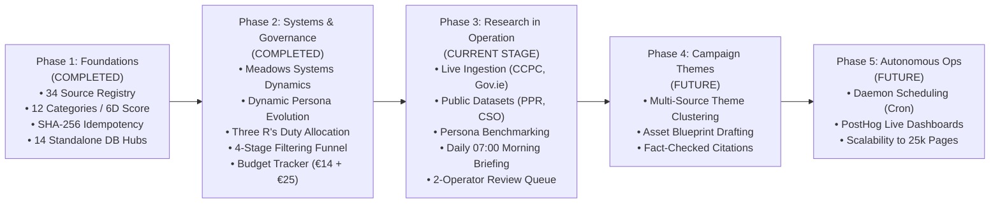

# HomePilot Market Intelligence Engine — Roadmap Review & Phase 3 Planning Blueprint

**Document Reference:** `HP-INTEL-ROADMAP-REVIEW-PHASE3-PLAN-v1.0`  
**Operational Scope:** Internal Intelligence & Research Platform (Dedicated for 2 Operators)  
**Strict Boundary Isolation:** 100% Independent of `Mortgage_calculator_QA` (Zero shared code, databases, or policies)  
**Current Milestone:** Phase 1 & 2 Complete & Audited (28/28 Tests Green) $\longrightarrow$ **Phase 3 Planning & Operationalization**  
**Budget Constraints:** Firecrawl €14 (5,000 pages) + xAI API €25 (Grok tokens) + Database $\le$ €10 (MongoDB Atlas M0 Free)  

---

> [!IMPORTANT]
> **Stage Confirmation**:
> You are entirely correct: we have completed and verified **Phase 1 (Foundations & Architecture)** and **Phase 2 (Systems Dynamics, Evolving Personas & Bilateral Governance)**. We are now in the **Planning & Execution Stage of Phase 3**, focusing strictly on the **empirical research engine** (live feed ingestion, statutory monitoring, public datasets, daily briefings, and persona benchmarking) without premature ad publishing.

---

## 1. Overall System Architecture & Phase Progression

---

## 2. Review of What Has Been Completed (Phases 1 & 2)

### Phase 1: Architectural Foundations, Ingestion & Boundaries (Verified)
- **Strict Boundary Isolation**: Complete separation from `Mortgage_calculator_QA`. Zero shared code, zero shared policies, zero dependencies.
- **Curated Irish Source Registry (`config/sources_registry.json`)**: 34 high-authority Irish sources registered across 6 ecosystems (Statutory, Consumer Oversight, Lenders, Developers, Market Commentary, Geospatial).
- **Core Intelligence Strategy (`config/homepilot_strategy.json`)**: 5 Strategic Dimensions, 12-Category versioned taxonomy (IRPM, HSRD, MFPL, FTBS, etc.), and 10 Strategic Questions.
- **Deterministic 6-Dimension Scoring (`src/intelligence/scoring.py`)**: Mathematical composite formula (0–100) weighting relevance (0.25), impact (0.25), confidence (0.20), timeliness (0.15), campaign alignment (0.10), and geography (0.05).
- **Document Normaliser & Deduplication (`src/normalisation/normaliser.py`)**: Canonical markdown extraction with SHA-256 hashing—unchanged pages consume **0 LLM tokens** and produce **0 duplicate database writes**.
- **xAI Grok Service (`src/intelligence/grok_service.py`)**: Token accounting, cost tracking, and deterministic local fallback mode.
- **Standalone Hub-and-Spoke Storage (`src/storage/repository.py`)**: 14 dedicated MongoDB collections with local memory fallback.
- **Coordination & API**: Redis 8-priority-queue manager (`src/coordination/queue_manager.py`) and FastAPI service on port 8000 (`src/api/intelligence_api.py`).

### Phase 2: Systems Thinking, Dynamic Personas & Governance (Verified)
- **Systems Dynamics Strategic Engine (`src/intelligence/strategic_engine.py`)**: Evaluates Meadows/Sterman stocks and flows (Buyer Cash Reserve vs Hidden Fee Drains), time lags (12–16 week conveyancing latency), second-order effects ("5 Whys"), and the **Iceberg Model** (uncovering the mental model *"borrowing capacity = homeownership readiness"*).
- **Dynamic Persona Engine (`src/intelligence/persona_engine.py`)**: Bridges the 5 foundational marketing personas (`seg_1` to `seg_5`) from the Launch Strategy document to live feeds, dynamically discovering new segments (`dyn_seg_commuter_cap_straddler`, `dyn_seg_grant_stacker`).
- **The Three R's Duty Allocation**: Inside the BPM Value Stream, duties are explicitly split between the **Automated Bot Squad** (scraping, deduplication, scoring) and **Human Operator Intervention** (the 2-person team validating statutory updates and spot-checking findings when confidence $< 85$).
- **Bilateral Communication Bridge (`src/intelligence/bilateral_bridge.py`)**: 
  - *Tier 1:* Python 4-stage filtering funnel (5,000 URLs $\rightarrow$ 2,000 irrelevant discarded, 1,500 cached discarded, 1,000 lightweight, 500 high-priority).
  - *Tier 2:* Bot-to-Bot cognitive exchange (Python delivers structured context; Grok returns analysis or requests missing evidence).
  - *Tier 3:* Human Operator Review Queue for statutory anomalies and sign-off.
- **PostHog Operational Telemetry (`src/observability/posthog_client.py`)**: Tracks 10 operational events within PostHog's free tier with strict privacy sanitization (zero customer/financial data transmitted).
- **Budget Governance Tracker (`src/coordination/budget_tracker.py`)**: Enforces hard quota guards for the **€14 Firecrawl (5,000 credits)** and **€25 xAI API ($27 USD)** baseline, keeping MongoDB $< €10$.
- **Test Suite Status**: **28 / 28 unit and integration tests passing (100% green)**; git repository tracked cleanly on `main`.

---

## 3. What Needs to Be Done: Phase 3 (The Empirical Research Engine in Operation)

In accordance with your mandate—**"only research bit of the next steps"**—Phase 3 operationalizes the research laboratory. We do not generate ad copy or publish social content in this phase; we focus entirely on extracting empirical truth from the Irish housing market.

### Phase 3 Core Workstreams & Deliverables

#### 3.1 Live Feed Connecting & Ingestion Activation
- Configure real credentials in `.env` (`FIRECRAWL_API_KEY`, `XAI_API_KEY`).
- Activate scheduled live polling on Tier 1 statutory anchors:
  - **CCPC Buying a Home Guides** (`ccpc.ie/consumers/money/buying-a-home/`)
  - **Citizens Information Housing Section** (`citizensinformation.ie/en/housing/`)
  - **Department of Housing Circulars** (`gov.ie/en/organisation/department-of-housing-local-government-and-heritage/`)
- Test real-world Firecrawl markdown scraping against live sites, verifying that 1 credit = 1 clean page.

#### 3.2 Public Open Dataset Connectors Activation
- **Property Price Register (PPR)**: Implement automated monthly/quarterly CSV batch downloader and parser for actual sold prices vs asking prices.
- **Central Statistics Office (CSO PxStat API)**: Connect to official tables:
  - Table `HPM05` (Residential Property Price Index by County & Buyer Type: First-Time Buyer vs Non-FTB).
  - Table `NDA02` (New Dwellings Completions by Local Authority).
- **Residential Tenancies Board (RTB)**: Ingest quarterly Rent Index to calculate the local *Buy vs. Rent monthly cash-flow differential*.

#### 3.3 Continuous Market-to-Persona Research Benchmarking
- Execute empirical investigations using [`ObjectiveResearchEngine`](file:///Users/samson/Documents/HomePilot's%20projects/External%20Website%20Research%20Tool/src/intelligence/research_engine.py):
  - **Investigation 1: Navan / County Meath Commuter Affordability Gap**:
    - Benchmark new build launch prices (€385k–€410k) against the Meath First Home Scheme regional cap (€375,000).
    - Map the exact friction points for `seg_1_frustrated_ftb` and `dyn_seg_commuter_cap_straddler`.
  - **Investigation 2: The Closing Cost Liquidity Deficit**:
    - Synthesize real transaction fee ranges (solicitor €2,500, stamp duty 1%, survey €600, valuation €400) and quantify the hidden cash barrier for `seg_3_homeownership_planner`.

#### 3.4 Automated Daily Intelligence Briefing Generator
- Implement the morning briefing engine (scheduled for 07:00 UTC daily):
  - Queries all `market_insights` recorded in the last 24 hours with composite score $\ge 70$.
  - Generates a concise, 2-page executive markdown brief for the 2 operators:
    - *What Happened in the Market (Verified Facts)*
    - *Which Personas are Affected*
    - *Systemic Bottlenecks & Closing Friction Identified*
    - *Recommended Product Feature Highlight (e.g. Total Acquisition Buffer Planner)*

#### 3.5 2-Person Operator Interactive Review CLI / API
- Provide simple operator commands to review staged findings:
  - `python cli.py list-reviews` (shows pending items where confidence $< 85$ or policy changed).
  - `python cli.py approve-review --id <task_id> --feedback "Verified against Gazette"`
  - `python cli.py reject-review --id <task_id>`

---

## 4. The Next Few Phases (High-Level Overview)

### Phase 4: Theme Clustering & Campaign Asset Blueprints (Future)
*Triggered once the research engine is reliably generating clean empirical insights.*
1. **Multi-Source Theme Clustering**:
   - Algorithms that cluster related findings across categories into overarching strategic opportunities (e.g., *"The Commuter Equity Squeeze"* combining PPR data + FHS price caps + Cairn launch notices).
2. **Asset Blueprint Generator**:
   - Produces structured drafts for marketing campaigns (educational carousels, X analytical threads, video storyboards, strategic briefs) based on the Launch Strategy templates.
   - Enforces HomePilot's "Trusted Guide" tone (no bank jargon, no fear-based selling).
   - Strict citation requirement: every asset must reference at least two primary evidence IDs (e.g. `PPR-2026-Q3`, `CCPC-GUIDE-04`).
3. **Operator Sign-Off Workflow**:
   - The 2 operators review generated drafts before anything is scheduled for publication.

### Phase 5: Autonomous Production Operations & Scalability (Future)
*Triggered when transitioning to standing background automation.*
1. **Background Worker Daemon**:
   - Run via Docker / Render / systemd with automatic health checks and graceful restarts.
   - Scheduled cron jobs aligned with the source frequency matrix (Daily, Every 2–3 Days, Weekly).
2. **PostHog Live Operational Dashboards**:
   - Pre-configured PostHog dashboard for the 2 operators displaying:
     - Real-time monthly crawl credits used (vs 5,000 quota).
     - xAI Grok USD spent (vs $27.00 budget ceiling).
     - Pages processed via free SHA-256 cache (dollars saved).
     - Active candidate sources awaiting review.
3. **Scale-Out Path (Tier 2 Expansion)**:
   - When expanding beyond 5,000 pages to 20,000+ pages, scale up Firecrawl and MongoDB M2 with zero architectural rewrites.

---

## 5. Phase 3 Execution Checklist & Immediate Next Steps

| Task | Priority | Status |
| :--- | :--- | :--- |
| **Verify Budget Tracker & Quotas in CLI** | High | Done (28/28 tests passing) |
| **PPR (Property Price Register) Connector** | High | Next Step |
| **CSO PxStat API Connector (HPM05 & NDA02)** | High | Next Step |
| **Daily Morning Briefing Generator (07:00 UTC)**| High | Next Step |
| **Live Commuter Affordability Research Run** | Medium | Next Step |
| **Operator Interactive Review Workflow in CLI** | Medium | Next Step |

All foundations are locked, robustly tested, and fully isolated from other products.
