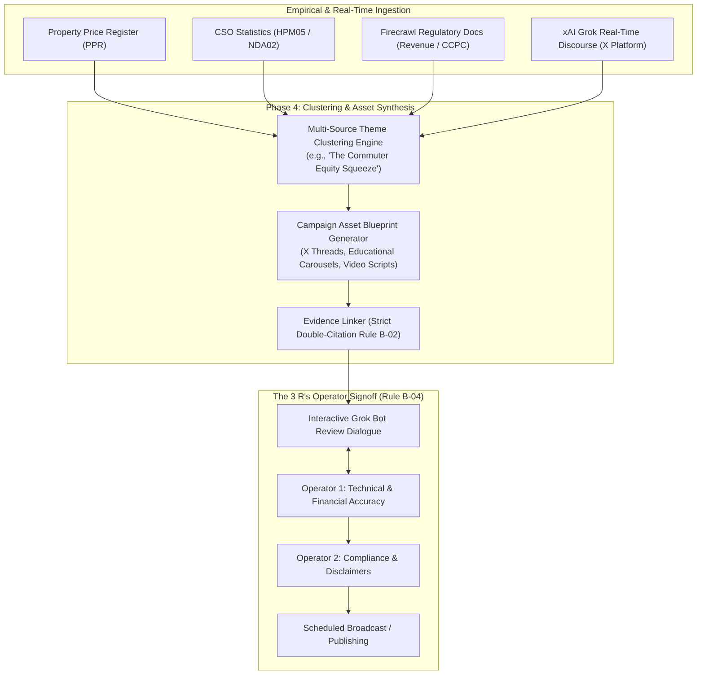
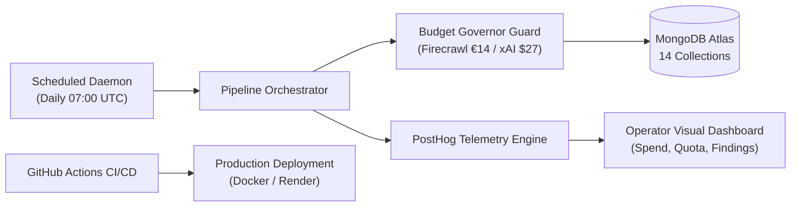

# HomePilot Research Engine: Phase 4 & Phase 5 Roadmap and GitHub Setup

## 1. Executive Summary

With **Phases 1, 2, and 3 fully completed and verified** (50/50 tests green, live MongoDB 14-collection architecture active, live Firecrawl and xAI APIs operational and cost-metered), the project transitions into **Phase 4 (Theme Clustering & Campaign Asset Blueprints)** and **Phase 5 (Autonomous Production Operations & Scaling)**.

This document details:
1. **GitHub Repository Setup**: What is done locally and the exact steps to connect to a remote GitHub repository.
2. **Phase 4 Scope & Architecture**: Multi-source theme clustering, asset blueprint generation, and interactive Grok Bot operator review dialogue.
3. **Phase 5 Scope & Architecture**: Background daemon scheduling (07:00 UTC), PostHog operational telemetry dashboards, and CI/CD automation.

---

## 2. GitHub Repository Status & Next Steps

### Current Local State
- **Git Initialized**: Working tree is 100% clean on branch `main`.
- **Commit History**: Complete history tracking Phase 1 through Phase 3 milestones.
- **Security & Privacy Safeguards**:
  - `.env` (holding live API keys for Firecrawl and xAI) is strictly excluded via `.gitignore`.
  - `config/budget_burn_state.json`, `__pycache__`, and `.pytest_cache` are ignored.
- **Remote Status**: **No remote GitHub URL is currently attached** (`git remote -v` is empty).

### Steps to Link to GitHub
To publish the codebase to your GitHub account:
1. Go to [GitHub New Repository](https://github.com/new) and create a repository (e.g. `homepilot-external-research-tool`). Recommend setting it to **Private**.
2. Run the following commands in the workspace terminal:
```bash
# Add your GitHub remote
git remote add origin https://github.com/<your-github-username>/homepilot-external-research-tool.git

# Push the verified main branch
git push -u origin main
```
*(Alternatively, if you provide your repository URL, the assistant can execute `git remote add origin <URL>` for you).*

---

## 3. Phase 4: Multi-Source Theme Clustering & Campaign Asset Blueprints

Phase 4 focuses on turning raw empirical findings and X discourse into **structured, compliant marketing campaigns and educational assets**.



### Deliverables in Phase 4:
1. **Multi-Source Theme Clustering (`src/intelligence/theme_clustering.py`)**:
   - Synthesizes trends across multiple distinct sources.
   - Example Theme: *"The Commuter Equity Squeeze"* — combines CSO house price index (+8.5%), PPR transaction spikes in Naas/Navan, First Home Scheme €375k price caps, and Grok X sentiment threads showing 62% buyer frustration.
2. **Asset Blueprint Generator (`src/generators/asset_blueprint.py`)**:
   - Generates production-ready creative assets:
     - **X Analytical Threads**: 5–7 post threads with step-by-step breakdown.
     - **Educational Carousels**: 6-slide visual scripts for Instagram/LinkedIn.
     - **Short-Form Video Storyboards**: 30–60 second scripts with hook, body, and CTA.
   - **Enforces Strict Rule B-02 (Double-Citation)**: Every draft must cite at least two primary evidence records from the MongoDB `evidence_records` collection.
3. **Interactive Grok Bot Review CLI (`cli.py operator-review`)**:
   - Allows operators to converse with the Grok Bot:
     - `"Grok, make slide 3 less aggressive about the developer delays."`
     - `"Grok, add a disclaimer about Central Bank 4.0x income limits."`
     - Grok Bot updates the document in MongoDB (`content_assets`) and logs operator feedback.

---

## 4. Phase 5: Autonomous Production Operations & Scalability

Phase 5 transitions the system from CLI-triggered research into a **standing, resilient production infrastructure**.



### Deliverables in Phase 5:
1. **Automated Background Daemon & Scheduler (`src/scheduling/daemon.py`)**:
   - Automates morning briefing generation (daily at 07:00 UTC).
   - Manages periodic source recrawls according to the cadence matrix (Daily, Every 2–3 Days, Weekly).
   - Graceful restart, process isolation, and log rotation.
2. **PostHog Live Operational Telemetry Dashboards**:
   - Visual dashboard for the two operators monitoring:
     - Real-time monthly Firecrawl credit burn (out of 5,000 quota).
     - Live xAI USD spend (out of $27.00 USD monthly ceiling).
     - SHA-256 cache hit rate (% of pages processed for €0).
     - Pending items in the Operator Review Queue.
3. **CI/CD Automation via GitHub Actions (`.github/workflows/ci.yml`)**:
   - Automated `pytest` execution on every pull request.
   - Secret scanning and schema integrity checks.
   - Budget regression tests.
4. **Containerization & Deployment (`Dockerfile`, `docker-compose.yml`)**:
   - Containerized multi-service deployment with healthcheck endpoints.

---

## 5. Implementation Roadmap Summary

| Phase | Core Objective | Key Capabilities | Status |
| :--- | :--- | :--- | :--- |
| **Phase 1** | Ingestion & Normalization Foundation | 35 sources, Firecrawl connector, 12 categories, 6-dim scoring | **COMPLETED** |
| **Phase 2** | Systems Thinking & Persona Alignment | 5 FTB audience personas, bilateral bridge, diff engine | **COMPLETED** |
| **Phase 3** | Quantitative Connectors & Live APIs | PPR, CSO StatBank, RTB, Live xAI Grok, Live MongoDB 14 collections | **COMPLETED** |
| **Phase 4** | Theme Clustering & Campaign Blueprints | Cross-source clustering, asset blueprinting, interactive Grok Bot CLI | **NEXT UP** |
| **Phase 5** | Production Daemon, Dashboards & CI/CD | 07:00 UTC scheduler, PostHog dashboards, GitHub Actions, Docker | **FINAL PHASE** |
