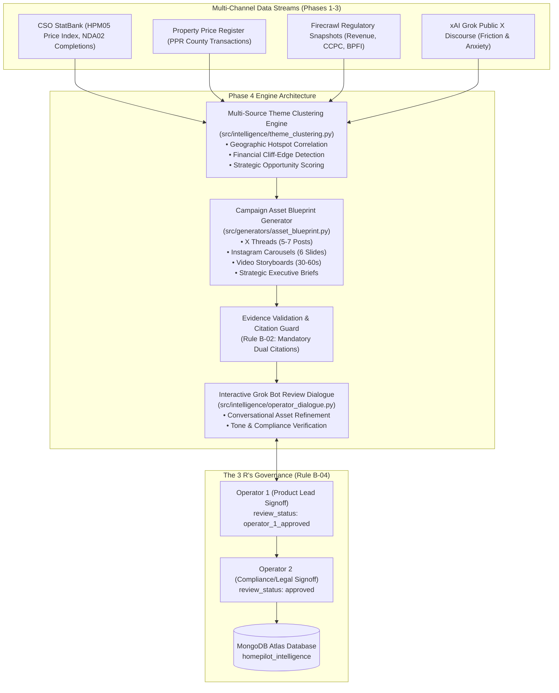
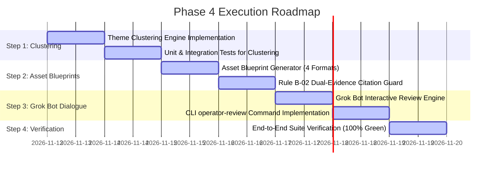

# HomePilot Phase 4: Deep Research & Execution Plan
## Multi-Source Theme Clustering & Campaign Asset Blueprints

## 1. Executive Summary & Objective

**Phase 4** elevates the HomePilot External Website Research Tool from an empirical data collector and sentiment listener into an **automated thematic synthesis and strategic asset blueprinting engine**. 

While Phases 1 through 3 established the pipelines, quantitative connectors (PPR, CSO, RTB), live Firecrawl scraping, live xAI Grok X sentiment analysis, and the 14-collection MongoDB database, Phase 4 answers the core business challenge:
> *"How do we continuously translate complex housing statistics, regulatory policy updates, and real-time social friction into verified, jargon-free educational content assets that position HomePilot as the definitive, trusted Homeownership OS?"*

---

## 2. Core Pillars of Phase 4

---

## 3. Detailed Component Architecture

### Pillar 1: Multi-Source Theme Clustering Engine (`src/intelligence/theme_clustering.py`)
- **Purpose**: Correlates quantitative numbers (PPR/CSO) with regulatory policies (Firecrawl) and qualitative social friction (xAI Grok) into unified **Strategic Opportunity Themes**.
- **Clustering Heuristics**:
  1. **Geographic Correlation**: Aligns county-level price trends (e.g. Meath median €365k) with local First Home Scheme caps (€375k) and buyer commuter threads.
  2. **Financial Cliff-Edge Detection**: Identifies gaps where developer launch prices exceed state subsidy limits (e.g. €420k new-build launch vs €30k HTB ceiling).
  3. **Timing & Process Bottlenecks**: Identifies mismatches between loan offer validity (120–180 days) and construction handover lags (9–14 months).
- **Theme Output Structure**:
  - `theme_id`: e.g., `theme_commuter_equity_squeeze_meath`
  - `title`: *"The Commuter Equity Squeeze: Kildare & Meath Affordability Cliff"*
  - `problem_statement`: Empirical summary of buyer challenge
  - `homepilot_tool_fit`: Primary HomePilot tool addressing the gap (e.g., Scenario Simulator)
  - `contributing_signals`: Linked source IDs from PPR, CSO, Firecrawl, and xAI Grok.

### Pillar 2: Campaign Asset Blueprint Generator (`src/generators/asset_blueprint.py`)
- **Purpose**: Transforms clustered themes into structured, platform-optimized asset drafts stored in MongoDB `content_assets`.
- **Supported Formats**:
  1. `x_thread`: 5–7 post breakdown with opening hook, data snapshot, the hidden catch, calculation walkthrough, and HomePilot tool link.
  2. `instagram_carousel`: 6 slide cards structured with visual cues, slide headline, concise body copy, and CTA.
  3. `short_form_video_script`: 30–60 second TikTok/Reels/Shorts script formatted with visual camera directions, spoken voiceover, on-screen text, and CTA.
  4. `strategic_brief`: 1-page internal executive summary detailing market risk, consumer sentiment, and competitive advantage.
- **Rule B-02 (Strict Dual-Evidence Citation)**:
  - Every generated asset must explicitly link $\ge 2$ primary evidence IDs (e.g., `PPR-2026-MEATH-Q1`, `CSO-HPM05`, `REVENUE-HTB-2026`).
  - If fewer than 2 citations exist, the asset generation is rejected with `EvidenceDeficiencyError`.
- **"Trusted Guide" Persona Guard**:
  - Enforces empathetic, factual, non-judgmental language.
  - Strips banking jargon (replaces "LTI macroprudential limit" with "Central Bank 4-times income cap").
  - Forbids fear-based marketing, political finger-pointing, or unvetted financial advice.

### Pillar 3: Interactive Grok Bot Review Dialogue (`src/intelligence/operator_dialogue.py`)
- **Purpose**: Implements the conversational partner role for Grok Bot under **The 3 R's Governance (Rule B-04)**.
- **Operational Workflow**:
  1. Operator launches `python cli.py operator-review`.
  2. CLI displays pending blueprints from MongoDB `content_assets`.
  3. Operator selects an asset and can:
     - Review the payload, evidence citations, and reviewer notes.
     - Issue conversational commands to Grok Bot:
       - *"Grok, make slide 3 less aggressive about developer delays."*
       - *"Grok, add a clear disclaimer that Central Bank exemptions are capped at 15% of lender quotas."*
     - Grok Bot calls xAI, updates the asset payload in-memory, and shows the updated preview.
     - Operator 1 (Product Lead) enters signature $\rightarrow$ Status advances to `operator_1_approved`.
     - Operator 2 (Compliance Lead) enters signature $\rightarrow$ Status advances to `approved`.
     - Or marks `revisions_requested` / `rejected`.

---

## 4. Database Schema Alignment (MongoDB)

All Phase 4 data integrates seamlessly into the 14-collection MongoDB Hub-and-Spoke database (`homepilot_intelligence`):

| Collection Name | Phase 4 Entity Stored | Key Schema Fields |
| :--- | :--- | :--- |
| `campaign_opportunities` | Clustered Strategic Themes | `campaign_id`, `theme_title`, `target_segment`, `central_customer_problem`, `homepilot_positioning_hook`, `status` |
| `content_assets` | Generated Blueprints | `asset_id`, `campaign_id`, `asset_type`, `content_payload` (headline, copy, slides, citations), `review_status`, `reviewer_notes`, `reviewed_by` |
| `evidence_records` | Verification Sources | `evidence_id`, `source_id`, `extracted_quote`, `stat_metric`, `verified_at` |
| `agent_runs` | Operator Review Audit Trail | `run_id`, `agent_name` ("grok_bot"), `operator_id`, `action_taken`, `prompt_tokens`, `completion_tokens`, `cost_usd` |

---

## 5. Phased Execution Roadmap & Milestones

### Milestone Checklist:
- [x] Step 1: Create `src/intelligence/theme_clustering.py` and write unit tests in `tests/test_theme_clustering.py`.
- [x] Step 2: Create `src/generators/asset_blueprint.py` with Rule B-02 citation validation and write unit tests in `tests/test_asset_blueprint.py`.
- [x] Step 3: Create `src/intelligence/operator_dialogue.py` with Grok Bot revision loop and dual operator signoff.
- [x] Step 4: Add `cli.py cluster-themes` and `cli.py operator-review` commands.
- [x] Step 5: Verify live MongoDB persistence and run the entire pytest test suite.
