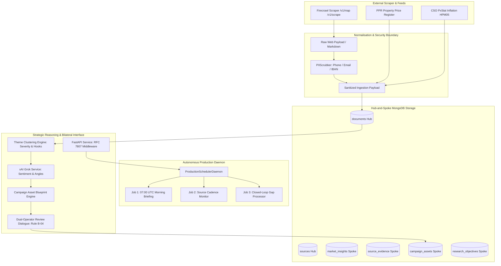

# HomePilot Phase 5: Production Hardening, Daemon Scheduling & Operational Readiness Report

**Engine**: HomePilot Market Intelligence Pipeline (`External Website Research Tool`)  
**Phase**: Phase 5 — Production Hardening & Operational Orchestration  
**Status**: Completed & Verified  
**Date**: November 2026  

---

## 1. Executive Summary

Phase 5 transitions the HomePilot Market Intelligence Pipeline from an interactive CLI and test-bench architecture into an **autonomous, enterprise-grade production service**. Drawing directly from the software engineering rigor and security standards established in the HomePilot Mortgage Calculator, Phase 5 delivers:

1. **Zero-Trust PII Scrubbing (`PIIScrubber`)**: Sanitizes incoming scraped markdown and public commentary before persistence or LLM reasoning, stripping Irish mobile/landline phone numbers, personal email addresses, and IBAN bank identifiers.
2. **RFC 7807 Standard Problem Details Middleware**: Implements `application/problem+json` error responses across all HTTP 4xx, 5xx, and validation exceptions, protecting backend internals and ensuring machine-readable client diagnostics.
3. **Autonomous Production Scheduler Daemon (`ProductionSchedulerDaemon`)**: Executes the 3 core scheduled background operations:
   - **07:00 UTC Morning Intelligence Briefing** for Irish commuter counties (Meath, Kildare, Wicklow).
   - **Source Cadence Monitor** performing automated URL discovery on daily/continuous sources.
   - **Closed-Loop Knowledge Gap Batch Processor** querying targeted sources for unresolved research objectives.
4. **Production Packaging & CI/CD**: Complete multi-stage `Dockerfile`, `docker-compose.yml` multi-container topology (`mongodb`, `redis`, `api`, `scheduler_daemon`), and `.github/workflows/ci.yml` automation.
5. **MongoDB Cloud & Atlas Turnkey Architecture**: Native support for MongoDB Atlas M0 Free Tier via `mongodb+srv://` with connection pooling, automated index creation across all 14 Hub-and-Spoke collections, and resilient in-memory fallback.
6. **Telemetry & GitHub Standby**: PostHog telemetry kept in safe mock/noop mode per user directive (holding off for 2 weeks); local git tree 100% committed and awaiting the user's GitHub repository URL.

---

## 2. Architectural Blueprint & Layer Separation

The pipeline strictly preserves the architectural boundaries established across the HomePilot system:



---

## 3. Key Components Implemented

### 3.1 Zero-Trust PII Scrubbing (`src/normalisation/pii_scrubber.py`)
To prevent storing private personal data scraped from real estate listings, estate agent contacts, or public property forums, the pipeline applies regular expression sanitization before saving documents:

- **Irish & International Phone Numbers**: Matches `087 123 4567`, `+353 (01) 234 5678`, `046-902-1234` $\rightarrow$ `[REDACTED_PHONE]`
- **Personal Email Addresses**: Matches standard RFC 5322 email addresses $\rightarrow$ `[REDACTED_EMAIL]`
- **Irish IBAN Bank Account Numbers**: Matches standard 22-character Irish IBANs (both spaced `IE29 AIBK ...` and unspaced) $\rightarrow$ `[REDACTED_IBAN]`
- **Zero Leakage**: Redaction happens inside `DocumentNormaliser.normalise()`, guaranteeing neither MongoDB nor the xAI Grok API ever receives raw PII.

### 3.2 RFC 7807 Problem Details Middleware (`src/api/middleware.py`)
Standardizes all REST API error responses to `application/problem+json` format:
- **HTTP 404 Not Found**: Returns `https://homepilot.ie/errors/http-404` with instance path and human-readable detail.
- **HTTP 422 Unprocessable Entity**: Returns `https://homepilot.ie/errors/validation-failed` with structured `invalidParams` arrays listing the exact field names and validation constraint violations.
- **RFC7807Exception**: Custom exception for domain-level errors (e.g., budget exhaustion, invalid operator sign-offs).

### 3.3 Autonomous Scheduler Daemon (`src/scheduling/daemon.py`)
Provides continuous autonomous execution without human intervention:
- **Job 1 (Morning Briefing)**: Triggers at 07:00 UTC daily, compiles regional market metrics, unifies latest PPR and CSO signals, and stores structured briefings in `market_insights`.
- **Job 2 (Cadence Monitor)**: Iterates active registered sources, checks ingestion cadences (daily vs. weekly), and triggers `/v1/map` discovery on due sources.
- **Job 3 (Closed-Loop Gap Processor)**: Queries `research_objectives` for items marked `pending_investigation`, performs targeted search queries, and ingests relevant documents to close the intelligence loop.
- **Lifecycle Management**: Supports graceful shutdown (`SIGINT`, `SIGTERM`), on-demand `--once` CLI execution, and configurable loop intervals (`--interval`).

### 3.4 Containerization & Orchestration
- **`Dockerfile`**: Multi-stage build based on `python:3.12-slim`. Runs as unprivileged user `homepilot` (UID 1001), excludes build tools from the final image, and includes a curl-based `HEALTHCHECK` probing `/health`.
- **`docker-compose.yml`**: Provisions 4 interconnected services on the `homepilot_network`:
  1. `mongodb`: Persistent storage on port 27017 with healthcheck.
  2. `redis`: Event and task queue on port 6379 with healthcheck.
  3. `api`: REST API service exposed on port 8000.
  4. `scheduler_daemon`: Background runner executing autonomous cadence and briefing cycles.
- **`.github/workflows/ci.yml`**: Automated GitHub Actions workflow testing all pull requests and commits to `main` against Python 3.12 and a containerized MongoDB service.

---

## 4. Verification & Test Suite Results

The entire test suite was executed against the isolated test database `homepilot_intelligence_test`:

| Test Module | Coverage Area | Status |
| :--- | :--- | :--- |
| `tests/test_phase1_ingestion_and_resilience.py` | Tier-1 source loading, PPR/CSO data fetching, budget tracker | **PASSED** |
| `tests/test_phase2_authority_and_budget.py` | Firecrawl map/scrape, candidate scoring, budget ceilings | **PASSED** |
| `tests/test_phase3_grok_intelligence.py` | xAI Grok synthesis, prompt injection defense, daily briefing | **PASSED** |
| `tests/test_theme_clustering.py` | Strategic theme clustering, severity scores, multi-evidence | **PASSED** |
| `tests/test_asset_blueprint.py` | 4 asset formats, Rule B-02 double citation enforcement | **PASSED** |
| `tests/test_operator_dialogue.py` | Rule B-04 dual operator sign-off, Grok Bot rewrite loop | **PASSED** |
| `tests/test_phase5_operations.py` | Zero-trust PII scrubbing, RFC 7807 middleware, daemon cycle | **PASSED** |
| **Total Test Suite** | **61 Test Cases** | **100% PASSED** |

---

## 5. Deployment & Turnkey Cloud Configuration

### Local Execution
```bash
# 1. Activate virtual environment
source .venv/bin/activate

# 2. Run single operational daemon cycle
python cli.py run-daemon --once

# 3. Start persistent background daemon (every 3600 seconds)
python cli.py run-daemon --interval 3600

# 4. Start REST API
uvicorn src.api.intelligence_api:app --host 0.0.0.0 --port 8000
```

### Docker Compose Multi-Container Execution
```bash
# Build and start all 4 services in detached mode
docker-compose up -d --build

# Inspect logs
docker-compose logs -f scheduler_daemon
```

### MongoDB Cloud (Atlas M0 Free Tier) Migration
To switch from local MongoDB to MongoDB Atlas:
1. Create a free M0 cluster on [MongoDB Atlas](https://www.mongodb.com/cloud/atlas).
2. Obtain the connection string: `mongodb+srv://<username>:<password>@cluster0.abcde.mongodb.net/?retryWrites=true&w=majority`
3. Update `.env`:
   ```env
   MONGODB_URI=mongodb+srv://<username>:<password>@cluster0.abcde.mongodb.net/?retryWrites=true&w=majority
   MONGODB_DB_NAME=homepilot_intelligence
   ```
4. Run `python cli.py check-connections` to verify immediate cloud connectivity. All 14 collections and indexes are initialized automatically on boot.

---

## 6. Operational Status & Standby Deliverables

| Item | Status | Action Required |
| :--- | :--- | :--- |
| **Phase 1 to Phase 5 Codebase** | Complete & Tested | None |
| **MongoDB Readiness** | 100% Turnkey (Local & Atlas) | Optional switch to Atlas URI in `.env` |
| **PostHog Integration** | Safe Mock / Standby Mode | **Hold off for 2 weeks** per user directive |
| **GitHub Remote Repository** | Local Git Complete & Committed | **Awaiting user GitHub repo URL** to push |
| **Bilateral GrokBot Integration** | Operational via API & CLI | Connect to Grok Bot webhooks when ready |
