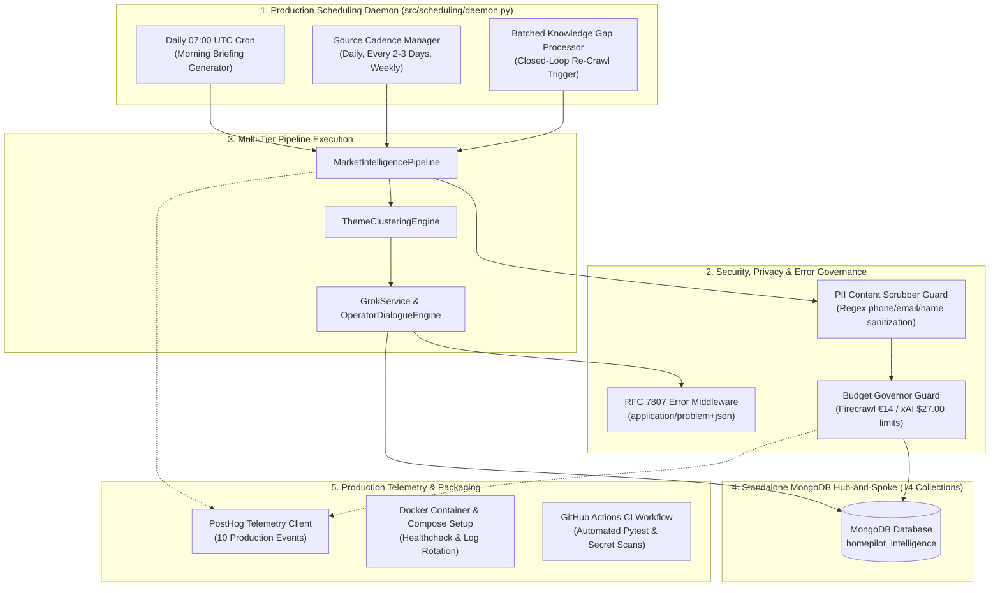

# HomePilot Phase 5: Autonomous Production Operations, Security & Scalability
## Master Architectural Specification & Execution Plan

## 1. Executive Summary & Engineering Mindset

Drawing directly from the rigorous engineering principles established in the **HomePilot Mortgage Calculator** (layered domain isolation, zero-trust validation, Hub-and-Spoke data partitioning, RFC 7807 error standards, and defense-in-depth security), **Phase 5** transitions the **Market Intelligence Research Tool** into an **autonomous, self-governing production system**.

While tailored to a focused **2-person operator team** with strict cost constraints (€14 Firecrawl + $27 xAI + <€10 MongoDB), the engineering architecture adheres to enterprise-grade software standards:
1. **Autonomous Background Daemon (`src/scheduling/daemon.py`)**: Standalone scheduler coordinating 07:00 UTC Daily Morning Briefings and scheduled source recrawls.
2. **RFC 7807 Standardized Problem Details**: Uniform error responses (`application/problem+json`) across all FastAPI endpoints.
3. **Zero-Trust Security & PII Sanitization Guard**: Content scrubbers stripping PII (emails, phone numbers, individual names) from scraped web documents before persistence.
4. **PostHog Operational Telemetry Dashboards**: Real-time visual tracking of credit consumption, token burn, cache hit ratios, and operator sign-off throughput.
5. **Containerization & CI/CD Pipeline (`Dockerfile`, `docker-compose.yml`, GitHub Actions)**: Production packaging with automated test gates.

---

## 2. Engineering Parallels: Mortgage Calculator vs. Research Engine

```
     MORTGAGE CALCULATOR (Consumer Facing)             RESEARCH ENGINE (Internal Operator)
 ┌───────────────────────────────────────────┐     ┌───────────────────────────────────────────┐
 │ • Strict TypeScript Compilation / NestJS  │     │ • Python 3.12 Type Annotations & Pydantic │
 │ • Hub-and-Spoke Model (Scenarios + Spokes)│     │ • 14 MongoDB Hub-and-Spoke Collections   │
 │ • Zero-Trust Client Math Policy           │     │ • Zero-Trust External Scraper Policy      │
 │ • RFC 7807 application/problem+json       │     │ • RFC 7807 Problem Detail Error Handling  │
 │ • OWASP ASVS v5.0 Security & Rate Limits  │     │ • Hard Budget Governors (€14 / $27 Caps)  │
 │ • 100% Coverage on Domain Math (Pure Fns) │     │ • Hermetic Test Isolation (conftest.py)   │
 └───────────────────────────────────────────┘     └───────────────────────────────────────────┘
```

---

## 3. Phase 5 System Architecture



---

## 4. Phase 5 Implementation Blueprint & Deliverables

### Deliverable 1: Autonomous Background Scheduler (`src/scheduling/daemon.py`)
- **Technology**: Lightweight Python scheduler using `APScheduler` or built-in asyncio scheduling (zero external heavyweight dependencies).
- **Scheduled Jobs**:
  1. `daily_morning_briefing`: Runs at **07:00 UTC** daily. Fetches PPR/CSO data, compiles executive brief, and logs telemetry.
  2. `source_cadence_monitor`: Runs daily at **02:00 UTC**. Scans 35 sources according to their cadence (`daily`, `every_3_days`, `weekly`).
  3. `closed_loop_gap_batcher`: Runs every 12 hours. Batches unanswered knowledge gaps from GrokBot and dispatches targeted Firecrawl scrapes.
- **Process Supervision**: Includes graceful SIGTERM/SIGINT signal handling and health check heartbeats.

### Deliverable 2: RFC 7807 Standard Error Handling & Security Middleware (`src/api/middleware.py`)
- **Format**: All API errors return `application/problem+json`:
  ```json
  {
    "type": "https://homepilot.ie/errors/budget-limit-exceeded",
    "title": "Budget Ceiling Quota Exceeded",
    "status": 429,
    "detail": "xAI Grok monthly budget ceiling ($27.00 USD) reached. Operation blocked.",
    "instance": "/v1/intelligence/analyze-x",
    "invalidParams": []
  }
  ```
- **PII Scrubbing (`src/normalisation/pii_scrubber.py`)**:
  - Scans scraped markdown using compiled regex patterns for Irish mobile/landline numbers, email addresses, and personal identifiable signatures.
  - Replaces sensitive entities with `[REDACTED_PII]` before saving to MongoDB `documents` collection.

### Deliverable 3: PostHog Live Telemetry Dashboard Spec (`src/observability/dashboard_spec.py`)
- Captures 10 operational telemetry events:
  1. `crawler.credits.consumed` (Firecrawl usage vs 5,000 cap).
  2. `grok.tokens.consumed` (xAI tokens & USD cost vs $27.00 cap).
  3. `document.cache.hit` (SHA-256 duplicate avoidance saving money).
  4. `theme.clustered` (New strategic opportunity created).
  5. `asset.blueprint.generated` (Draft created with Rule B-02 citations).
  6. `operator.review.approved` (Rule B-04 dual sign-off completed).
  7. `knowledge.gap.flagged` (Cold-spot gap identified).
  8. `knowledge.gap.resolved` (Targeted crawl completed).
  9. `daily.briefing.generated` (07:00 UTC run success).
  10. `pipeline.error.occurred` (Network/timeout error).

### Deliverable 4: Production Containerization & CI/CD Pipeline
- **`Dockerfile`**: Multi-stage build running on lightweight `python:3.12-slim`, non-root user (`homepilot`), and built-in healthcheck (`/health`).
- **`docker-compose.yml`**: Orchestrates:
  - `intelligence_api`: FastAPI web service on port 8000.
  - `intelligence_daemon`: Background scheduler running 24/7.
  - `mongodb`: Standalone MongoDB 7.0 container with persistent volume.
  - `redis`: Redis 7.0 cache for task queues.
- **GitHub Actions Workflow (`.github/workflows/ci.yml`)**:
  - Runs full `pytest` suite across all 54+ tests.
  - Enforces 0 failures, lint checks, and secret scanning.

---

## 5. Phase 5 Implementation Steps & Verification Checklist

| Step | Component | Priority | Verification Criteria |
| :--- | :--- | :--- | :--- |
| **5.1** | PII Scrubber & RFC 7807 Error Middleware | High | All API errors return RFC 7807 shapes; PII regex tests pass 100%. |
| **5.2** | Autonomous Scheduler Daemon | High | 07:00 UTC briefing and cadence loops execute with test verification. |
| **5.3** | Closed-Loop Gap Batch Ingestion | Medium | Unanswered knowledge gaps trigger targeted Firecrawl crawls. |
| **5.4** | PostHog Dashboard Configuration | Medium | 10 events registered and verified via mock/telemetry client. |
| **5.5** | Docker & GitHub Actions CI/CD | High | `Dockerfile` builds cleanly; `.github/workflows/ci.yml` validates PRs. |
| **5.6** | End-to-End Suite Verification | High | 100% green test suite across all 5 phases. |
