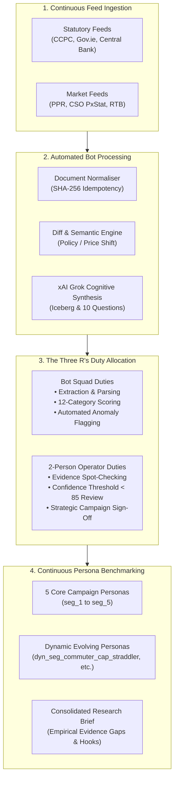

# HomePilot Objective Research Engine — Continuous Market-to-Persona Benchmarking

**Document Version:** 3.0.0-RESEARCH-EDITION  
**Project:** HomePilot Market Intelligence Researcher  
**Operating Environment:** Standalone Internal Platform (Strictly 2 Operators)  
**Boundary Isolation:** 100% Isolated from `Mortgage_calculator_QA` (Zero shared code, policies, or connections)  
**Foundational Campaign Source:** `(Initial_Launch_Strategy)_Audience_Persona_&_Content_Campaign_(1).docx.md`  

---

> [!IMPORTANT]
> **Strict Operational Boundary**:
> This intelligence tool is engineered exclusively for an internal team of **two operators**. It has **no connection, no imports, no links, and no shared database** with the mortgage calculator dashboard. Its sole purpose is continuous empirical market research, statutory feed ingestion, dynamic persona evolution, and objective-driven research synthesis.

---

## 1. Executive Summary & Research Value Stream

The **Objective Research Engine** transforms HomePilot from a reactive feed monitor into an empirical research laboratory. By continuously comparing raw statutory and market signals (PPR, Central Bank, CSO, RTB, Housing Agency) against the **5 Core Audience Personas** and newly discovered **Dynamic Segments**, the engine uncovers real-world frictions before they impact prospective homeowners.



---

## 2. Core Marketing Persona Alignment & Market Benchmarks

The research engine continuously benchmarks live feed signals against the 5 foundational personas defined in HomePilot's Launch Strategy:

| Segment ID | Persona Name | Demographics | Core Market Friction | Emotional Transition | Primary Strategic Hook |
| :--- | :--- | :--- | :--- | :--- | :--- |
| **`seg_1`** | **The Frustrated First-Time Buyer** | Age 28–40<br>€35k–€90k | Repeated calculator use; feels stuck; overwhelmed by bank jargon and hidden costs. | Confused & Anxious $\rightarrow$ **Certainty & Clear Roadmap** | *"Stop calculating borrowing limits. Start building your step-by-step homeownership plan."* |
| **`seg_2`** | **The Mortgage-Ready Optimiser** | Age 27–38<br>€60k–€120k+ | Financially ready but confused by Help to Buy (HTB) vs First Home Scheme (FHS) equity trade-offs. | Prepared but Cautious $\rightarrow$ **Strategic Optimization** | *"Being mortgage-ready isn't the same as being homeownership-ready. Optimize your scheme and rate strategy before you apply."* |
| **`seg_3`** | **The Homeownership Planner** | Age 28–45<br>€50k–€130k | Sale agreed; drowning in conveyancing delays, structural surveys, valuation deadlines, and closing fees. | Stressed & Frantic $\rightarrow$ **Task Visibility & Control** | *"Over 60 tasks stand between 'Sale Agreed' and 'Keys Collected'. Coordinate your purchase with clarity."* |
| **`seg_4`** | **The New Homeowner** | Age 29–45<br>€50k–€150k | Recently bought; cash-strapped after closing, managing unexpected furniture, renovation, and maintenance costs. | Relieved but Cash-Poor $\rightarrow$ **Budget Stability** | *"The journey doesn't end when you get the keys. Protect and budget for your home's ongoing health."* |
| **`seg_5`** | **The Future Wealth Builder** | Age 30–50<br>€70k–€180k+ | Wants to maximize equity growth, overpayment interest savings, green mortgage retrofits, and future upgrades. | Ambitious $\rightarrow$ **Equity Acceleration** | *"Your home is your largest financial asset. Build equity faster and shave years off your mortgage."* |

### Dynamically Discovered Feed Segments
When feeds show localized market divergence, the engine spawns dynamic personas:
- **`dyn_seg_commuter_cap_straddler` (The Commuter Price-Cap Straddler)**: Young buyers looking in Meath/Kildare/Wicklow where developer launch prices (€395k) exceed the local First Home Scheme county price ceiling (€375k), forcing a €20,000 equity shortfall.
- **`dyn_seg_grant_stacker` (The Vacant Property Grant Stacker)**: Buyers attempting to combine the Croí Cónaithe €50k/€70k grant with SEAI retrofit grants, constrained by the cash-flow delay of grants paid in arrears.

---

## 3. The Three R's Duty Allocation (Bot Squad vs. Human Operator)

Inside the research value stream, duties are explicitly partitioned to ensure operational speed without sacrificing verification rigor:

```
+-------------------------------------------------------------------------------+
|                           THE THREE R's FRAMEWORK                             |
+-------------------------------------------------------------------------------+
|  1. ROLE (Who does what):                                                     |
|     • Automated Bot Squad: Firecrawl crawler, Normaliser, Diff Engine,        |
|       and xAI Grok. (Ingestion, deduplication, scoring, 10-questions draft).  |
|     • 2-Person Human Operator Team: Validation gatekeeper, regulatory         |
|       statutory sanity checks, source promotion, and final research sign-off. |
|                                                                               |
|  2. RULE (Validation conditions & quality gates):                             |
|     • Bot Rule: SHA-256 hash match = 0 LLM tokens consumed (idempotent no-op).|
|     • Bot Rule: Composite Score >= 70 required to create MarketInsight.        |
|     • Human Rule: Confidence score < 85 triggers mandatory human review.      |
|     • Human Rule: Changes to statutory scheme price caps require human signoff|
|       before updating persona financial models.                               |
|                                                                               |
|  3. ROUTE (Workflow handoff sequence):                                        |
|     Feed Ingestion -> Normalisation -> Diff Detection -> Grok Synthesis ->   |
|     Operator Review Queue (if flagged) -> Active Knowledge Base & Personas.   |
+-------------------------------------------------------------------------------+
```

---

## 4. Systems Dynamics & Bottleneck Observations

The research engine applies Meadows/Sterman Systems Dynamics to identify market leverage points:

1. **Stocks as Buffers & Inflow/Outflow Mismatches**:
   - *Stock:* Buyer accumulated savings vs. Housing Inventory.
   - *Bottleneck:* The **Closing Cost Liquidity Trap**. Buyers commit 100% of their savings to the 10% mortgage deposit, neglecting the €7,500–€12,000 required for solicitor fees, 1% stamp duty, €500 valuation, and €600 structural survey.
2. **The Iceberg Model Root Cause**:
   - *Event:* Developer increases commuter home phase prices by €15,000.
   - *Pattern:* Asking prices consistently drift upwards to match the maximum state grant cap.
   - *Structure:* Central Bank 4.0x LTI rules and Help to Buy €30,000 threshold.
   - *Mental Model:* The pervasive consumer belief that *"If the bank approves €350,000, I am ready to buy a €350,000 home."* HomePilot's value is shifting this to *"Total Acquisition Readiness."*
3. **Time Delays & Transmission Lags**:
   - The structural **12–16 week latency** between "Sale Agreed" and loan drawdown creates extreme interest rate risk. If rates increase during this lag, buyers risk losing loan offer approval.

---

## 5. Verification & Test Execution Status

The research engine and persona benchmarking suite have been fully validated:

- **Active Test Suite:** `tests/test_research_engine.py`, `tests/test_phase2_execution.py`, `tests/test_persona_engine.py`, `tests/test_acceptance_phase1.py`.
- **Test Result:** **23 / 23 Tests Passing (100% Green)**.
- **Git Tracking:** Clean git repository initialized and tracked on branch `main` with `.gitignore` protecting environments and cache.
- **Execution Speed:** 23 tests complete in ~22 seconds with memory fallback and mock Grok mode.

```bash
source .venv/bin/activate && pytest -v
======================= 23 passed, 53 warnings in 22.89s =======================
```

---

## 6. CLI Research Operation Guide

The two operators can execute research runs and feed benchmarks on demand:

```bash
# 1. Load registered statutory sources
python cli.py load-sources

# 2. Discover URLs for statutory sources
python cli.py discover --source-id ccpc_homebuyers_guides --limit 20

# 3. Execute Objective Research on Navan Commuter Starter Homes
python cli.py run-research --title "Navan Commuter Starter Home Affordability Gap" --dimension "financial_confidence"

# 4. Run automated pilot workflow
python cli.py run-pilot
```
