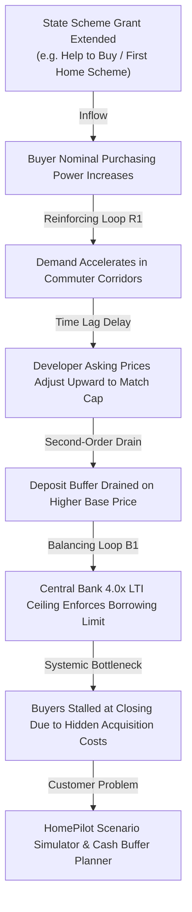
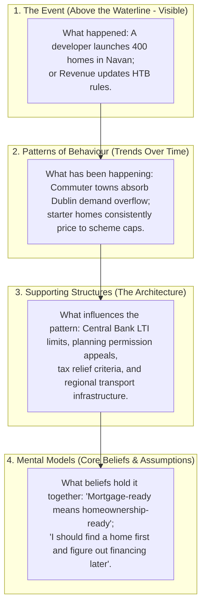
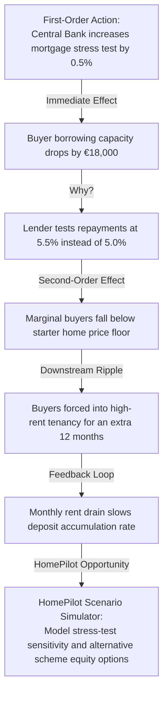
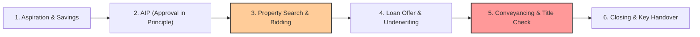

# HomePilot Market Intelligence Engine — Systems Dynamics & Strategic Reasoning Blueprint

**Version:** 2.0.0-SYSTEMS-DYNAMICS  
**Framework:** Systems Thinking, Stock & Flow Analysis, Iceberg Model, Bottleneck Theory, Second-Order Thinking & Business Process Management (BPM)  
**Target:** HomePilot Operational Intelligence & 10 Strategic Questions Engine  

---

## 1. Linear vs. Non-Linear Market Intelligence

Conventional real estate scraping relies on **linear thinking**:
$$\text{Event: Government increases subsidy} \longrightarrow \text{Action: Post that government gave money to buyers}$$

This reductionist "if-then" approach misses the cyclical, interconnected nature of the Irish homeownership ecosystem. In reality, market elements interact in non-linear feedback loops:

The **HomePilot Intelligence Engine** is built to see the whole system: its stocks, flows, feedback loops, delays, and underlying mental models.

---

## 2. The Dynamic Qualitative Source & Category Framework

The 30+ registered URLs and 12 categories are **dynamic baselines**, not static boundaries. Each source and category is evaluated through a **Qualitative Systems Profile**:

### Category Systems Profiles
| Category Code | Monitored System Stock | Flow Dynamic | Structural Delay / Time Lag | Core Bottleneck in Buyer Value Stream | Dominant Feedback Loop |
| :--- | :--- | :--- | :--- | :--- | :--- |
| **FTBS** (Buyer Schemes) | State Subsidy Pool & FTB Purchasing Power | Subsidy inflow vs. Developer price escalation outflow | Immediate grant pre-approval, but **3–6 month drawdown delay** at stage payments | Eligibility cliff-edges & regional price caps | **Reinforcing ($R_1$)**: Subsidies stimulate demand faster than supply responds |
| **MFPL** (Mortgage Planning) | Bank Lending Quotas & Household Debt Capacity | Monthly debt service outflow vs. Net disposable income inflow | **30–90 day lag** between Central Bank rate shifts and lender mortgage repricing | Central Bank 4.0x LTI ceiling & bank stress-test buffers (+1.5% to +2.0%) | **Balancing ($B_1$)**: Macroprudential rules act as systemic cooling brakes |
| **HSRD** (Housing Supply) | Active Construction Inventory (Commencements) | Construction starts inflow vs. Key handover completion outflow | **18–24 month structural lag** between planning approval and physical delivery | Civic infrastructure (Uisce Éireann water capacity, ESB substations) | **Balancing ($B_2$)**: Supply is sluggish; unable to respond quickly to surges |
| **IRPM** (Market Portals) | Listing Volumes & Aggregate Price Expectations | New listings inflow vs. Agreed sales contract outflow | Asking price indices reflect live sentiment; **PPR sold prices carry 60–90 day conveyancing lag** | Scarcity of turnkey second-hand starter homes in commuter corridors | **Reinforcing ($R_2$)**: Scarcity narrative fuels competitive bidding above valuation |
| **AFFR** (Financial Readiness) | Household Liquid Reserves & Emergency Cash Buffer | Monthly savings inflow vs. Rent inflation and closing cost outflows | **3–5 years** required for median household to accumulate 10% deposit + 3% fees | Non-mortgage closing costs (legal, survey, stamp duty, valuation) | **Balancing ($B_3$)**: Rising rents deplete savings rate, delaying readiness |

---

## 3. The Iceberg Model: Deepening the Strategic Reasoning

To generate high-authority intelligence, the engine penetrates four distinct layers of reality on every high-scoring finding:

### How HomePilot Leverages Mental Models
* The average consumer operates on a flawed mental model: *“If the bank approves me for €400,000, I can buy a €400,000 house.”*
* HomePilot’s positioning as a **Homeownership Operating System** directly targets and updates this mental model by showing that borrowing capacity is only one component of true homeownership readiness.

---

## 4. Second-Order Thinking & The "5 Whys" Integration

First-order thinking asks: *"What is the immediate, direct effect?"*  
Second-order thinking asks: *"And then what happens? What are the downstream systemic ripples?"*

---

## 5. Value Stream Analysis & Buyer Bottlenecks

In Business Process Management (BPM), the customer journey is an end-to-end **Value Stream** where the throughput of the entire system is strictly governed by its **bottlenecks**:

* **Bottleneck 1: Bidding War Friction (Stage 3)**: Asymmetry of information on true asking vs. achieved sold prices (PPR lag).
* **Bottleneck 2: Conveyancing & Title Defect Delays (Stage 5)**: Median cycle time of 12–16 weeks between sale agreed and drawdown, risking loan offer expiration.
* **Bottleneck 3: The Closing Cash Gap (Stage 5 to 6)**: Buyers exhaust 100% of savings on deposit, stalling when hit by legal fees, stamp duty, and engineer surveys.

---

## 6. The Dynamic 10 Strategic Questions Engine (Systems Edition)

For every insight scoring $\ge 70$, `StrategicEngine` evaluates the 10 questions through the Systems Dynamics lens:

1. **What happened?** (Factual development + verified source anchor).
2. **Why does it matter?** (Identifies the impacted **system stock** and the **time delay/lag** before market effects manifest).
3. **Who is affected?** (Identifies which buyer persona is constrained at their current value stream stage).
4. **What customer problem does it relate to?** (Identifies the **bottleneck constraint** and the **second-order ripple effect**).
5. **How does it connect to HomePilot?** (Shifts the user's **mental model** from linear borrowing to systems-level ownership readiness).
6. **Which product capability could help?** (Matches the bottleneck to HomePilot's Scenario Simulator, Cash Buffer Planner, or Scheme Comparer).
7. **Does it support an existing campaign?** (Binds insight to active themes like *"Mortgage-Ready vs. Homeownership-Ready"*).
8. **Does it create a new campaign opportunity?** (Spurs an educational piece explaining the second-order consequences of the event).
9. **Is the information time-sensitive?** (Evaluates the velocity of the feedback loop before market behavior locks in).
10. **What additional evidence is required?** (Identifies missing corroborating data from official statistical or regulatory stocks).

---

## 7. Concrete Example: Pilot Workflow Execution

Running the pilot ingestion through the Systems Thinking engine on a first-time buyer scheme update (`FTBS`):

* **Event**: Guidelines updated on First-Time Buyer Scheme eligibility and price thresholds.
* **Iceberg Layer**:
  - *Pattern*: Starter home prices rising in commuter counties to match scheme ceilings.
  - *Structure*: Central Bank LTI caps + Revenue HTB tax lookback rules.
  - *Mental Model*: Buyers assume qualifying for the scheme guarantees closing readiness.
* **Stocks & Flows**:
  - *Stock*: FTB Net Cash Reserve.
  - *Flow*: Subsidy inflow vs. closing fee drain.
  - *Lag*: 3–6 month construction drawdown window.
* **Bottleneck & Second-Order Effect**:
  - *Bottleneck*: Regional price caps creating geographic search displacement.
  - *Second-Order Effect*: Grant increases induce developers to raise base prices to match subsidy ceiling, shifting cost burdens back onto liquid cash reserves.
* **HomePilot Action**:
  - Generates educational carousel: *"Why your Help to Buy grant won't pay your closing legal fees."*
  - CTA: HomePilot Total Acquisition Cash Buffer Planner.
