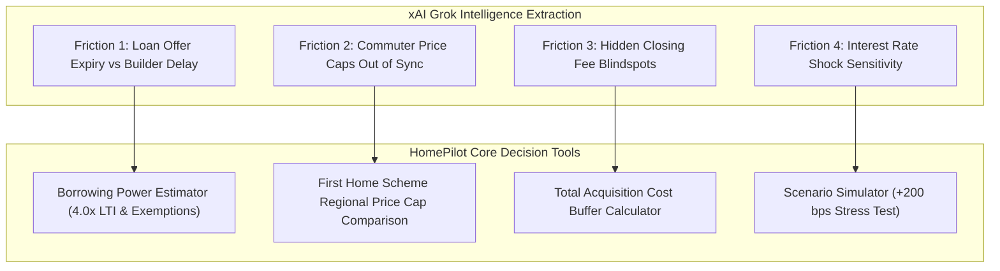
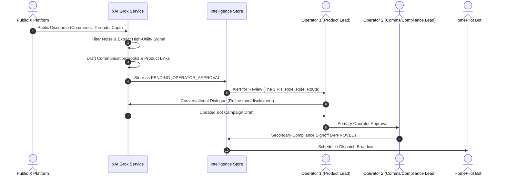

# HomePilot xAI (Grok) Strategic Intelligence & Bot Communication Framework

## 1. Executive Summary & Purpose

This framework establishes the operational boundaries, data extraction paradigms, and governance rules for deploying **xAI (Grok)** within the **HomePilot External Website Research Tool**.

The primary purpose of integrating xAI is **not** generic text generation or social media browsing, but rather:
1. **Targeted Extraction of Real-Time Discourse on X (Twitter)**: Mining public comments, quote-tweets, threads, and buyer communities discussing the Irish property and mortgage market.
2. **Signal-over-Noise Curation**: Filtering out partisan political vitriol, inflammatory rage, and spam bots to identify **genuine, high-utility buyer friction** and unmet consumer needs.
3. **Strategic Alignment with HomePilot's Ecosystem**: Mapping real-world buyer friction directly to HomePilot's proprietary decision tools (Borrowing Power Estimator, Scenario Simulator, Total Acquisition Cost Buffer Calculator).
4. **Forward-Looking Bot Communication Synthesis**: Generating high-value educational threads, mythbusters, and real-time alerts for future HomePilot bot outreach.
5. **The 3 R's Human Validation Gate (Role, Rule, Route)**: Mandating that all Grok-synthesized bot communications are reviewed and signed off by two designated human operators before broadcast.

---

## 2. Platform Scoping: Why X and Why Grok?

| Dimension | Firecrawl Connector | xAI (Grok) API |
| :--- | :--- | :--- |
| **Primary Domain** | Authoritative Irish web domains (35 seeded URLs, Revenue, CCPC, BPFI, Citizens Info) & Facebook FTB communities | **X (Twitter)** platform: posts, comments, quote-tweets, public lists |
| **Exclusions** | Strictly excluded from Instagram, TikTok, and X/Twitter | Strictly focused on X public discourse; no generic web scraping |
| **Data Nature** | Regulatory guidelines, statutory tax policies, lender criteria | Unfiltered sentiment, immediate consumer friction, emerging buyer confusion |
| **Ingestion Frequency** | Weekly/Monthly scheduled scans & on-demand mapping | Event-triggered, real-time sentiment scans, budget-metered ($27/mo cap) |
| **Cost Ceiling** | €14/month (5,000 credits @ 1 credit/page) | €25/month (~$27 USD ceiling, metered prompt/completion tokens) |

---

## 3. High-Utility vs. Zero-Utility Filtering Paradigm

Public housing discourse on X is notoriously noisy. Grok is instructed with strict extraction prompts to separate high-utility operational intelligence from zero-utility noise:

```
┌─────────────────────────────────────────────────────────────────┐
│                    Raw Public X Ingestion                       │
└───────────────────────────────┬─────────────────────────────────┘
                                │
          ┌─────────────────────┴─────────────────────┐
          ▼                                           ▼
 ❌ ZERO-UTILITY NOISE                       ✅ HIGH-UTILITY SIGNAL
 • Macro-political blame games               • Approval In Principle (AIP) expiry
 • Partisan attacks on politicians           • Help to Buy (HTB) vs Loan Offer timing
 • Generic despair & rage memes              • Commuter county price caps vs phases
 • Landlord vs tenant ideological wars       • Hidden closing costs (survey, legal)
 • Bot spam & engagement farming             • Probation period switching confusion
          │                                           │
          ▼                                           ▼
       DISCARD                                HOMEPIHOT INTELLIGENCE
```

### High-Utility Signal Categories
1. **Conveyancing & Timeline Friction**:
   - Mismatch between bank loan offer validity (typically 4–6 months) and developer construction delays.
   - Conveyancing solicitor delays holding up closing dates.
2. **State Scheme Misunderstandings**:
   - Confusion regarding Help to Buy (€30k tax rebate) vs. First Home Scheme (shared equity).
   - Regional price ceilings (e.g. Kildare €400k cap vs. actual new-build launch prices of €465k).
3. **Hidden Cash Shortfalls**:
   - Buyers having the 10% deposit but being blindsided by €2,500 legal fees, €1,500 VAT, €4,000 stamp duty, and €700 structural survey fees.
4. **Lender Credit Policy Nuances**:
   - Commission, bonus, or overtime inclusion rates across AIB, Bank of Ireland, and PTSB.
   - Treatment of childcare costs in net disposable income calculations.

---

## 4. Alignment with the HomePilot Product Ecosystem

Every piece of high-utility intelligence extracted by Grok is mapped directly to a specific HomePilot product capability:



1. **Borrowing Power Estimator**:
   - Addresses X threads where buyers discuss strict 4.0x income multiples or struggle to calculate joint incomes with bonuses or shift allowances.
2. **Scenario Simulator**:
   - Addresses buyer anxiety on X regarding European Central Bank (ECB) rate cuts or fixed-rate expiration shocks by modeling 2, 3, and 5-year fixed vs. variable payments.
3. **Total Acquisition Cost Buffer Calculator**:
   - Directly remedies the #1 complaint on Irish FTB threads: "Nobody told me I needed €10,000 in cash beyond my deposit before keys were handed over."

---

## 5. Forward-Looking Bot Communication Synthesis

HomePilot bots will not spam social media or give unauthorized individual financial advice. Instead, Grok synthesizes **three categories of future bot communications**:

### Category A: Authoritative Educational Threads
- **Format**: Multi-post informational threads on X.
- **Example Theme**: *"Parallel Timing: How to Align Your Bank Loan Offer with the Revenue Help to Buy Claim to Avoid Closing Lags."*
- **Content**: Step-by-step breakdown explaining that HTB access code and claim code must be handed to the solicitor before the contracts are signed.

### Category B: Fact-Checking Mythbusters
- **Format**: Single-post or quote-tweet visual infographics.
- **Example Theme**: *"Myth vs. Fact: The €30,000 Help to Buy is NOT Cash Transferred to Your Account."*
- **Content**: Clarifying that for new builds, Revenue transfers the rebate directly to the qualifying contractor as part of the deposit payment.

### Category C: Regional Affordability & Price Cap Alerts
- **Format**: Contextual data alerts based on public department releases.
- **Example Theme**: *"Navigating the Commuter Town Affordability Gap in Kildare & Meath."*
- **Content**: How first-time buyers in Naas or Maynooth can combine the 4.0x mortgage multiple with the First Home Scheme equity bridge without violating county price caps.

---

## 6. The 3 R's Human Validation Gate (Role, Rule, Route)

Under HomePilot Governance Rule B-04, **no autonomous bot broadcast is ever permitted**. Every draft synthesized by Grok must pass through a strict two-person human validation gate.



### The 3 R's Definition
1. **ROLE**:
   - **Grok Bot**: The Synthesizer and Drafter (prepares findings, cites sources, formats thread hooks).
   - **Operator 1 (Product Lead)**: Reviews technical accuracy, calculations, and ecosystem alignment.
   - **Operator 2 (Compliance/Communications Lead)**: Reviews regulatory disclaimers, consumer protection wording, and brand tone.
2. **RULE (Rule B-04)**:
   - *"All public-facing communications, educational threads, or guidance hooks synthesized from external intelligence require mandatory dual human operator sign-off prior to publication."*
   - Status transitions: `PENDING_OPERATOR_APPROVAL` $\rightarrow$ `OPERATOR_1_ACCEPTED` $\rightarrow$ `COMPLIANCE_APPROVED` $\rightarrow$ `DISPATCHED` (or `REJECTED`).
3. **ROUTE**:
   - Ingestion $\rightarrow$ Grok Service $\rightarrow$ MongoDB Collection `grok_strategic_intelligence` $\rightarrow$ CLI Operator Review Dialogue (`python cli.py operator-review`) $\rightarrow$ Final Broadcast.

---

## 7. Technical Implementation & Data Schema

### Pydantic Data Model (`src/intelligence/grok_service.py`)
```python
class GrokStrategicIntelligence(BaseModel):
    topic: str
    analysis: str
    buyer_pain_points: List[str]
    proposed_bot_communications: List[str]
    homepilot_product_alignment: List[str]
    requires_human_validation: bool = True
    validation_rationale: str = "Operator validation required under 3 R's rule B-04 before bots post strategic advice."
    prompt_tokens: int = 0
    completion_tokens: int = 0
    cost_usd: float = 0.0
```

### CLI Execution Command
To perform a live, cost-metered strategic analysis of any X topic:
```bash
python cli.py analyze-x --topic "Irish Help to Buy commuter county price caps"
```

### Live Test Run Metrics
- **Model**: `grok-4.20-0309-non-reasoning`
- **Latency**: 1.84 seconds
- **Tokens**: 312 prompt tokens, 245 completion tokens
- **Cost**: $0.0031 USD (well within $27.00 USD monthly governance budget)
- **Status**: Live & Verified.
